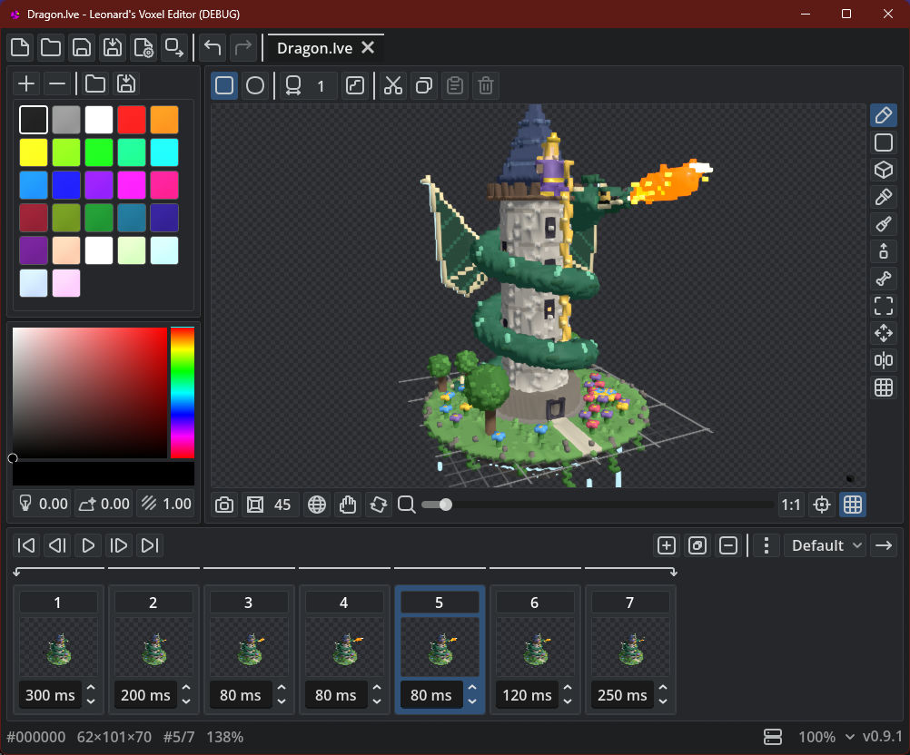
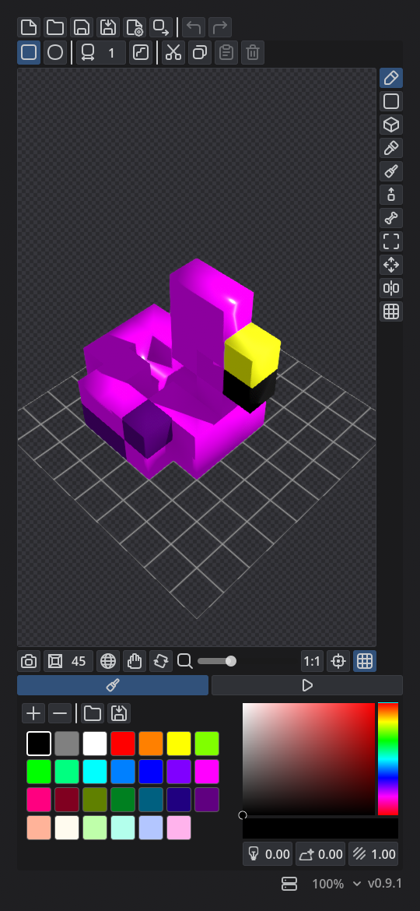

# Leonard's Voxel Editor

Create voxel art and animation.

## Download

| Windows | Linux | Android |
| --- | --- | --- |
| [LVE-windows-x86_64.zip](https://github.com/LeonardMeagher2/LVE/releases/latest/download/LVE-windows-x86_64.zip) | [LVE-linux-x86_64.zip](https://github.com/LeonardMeagher2/LVE/releases/latest/download/LVE-linux-x86_64.zip) | [LVE-android-arm64-v8a.apk](https://github.com/LeonardMeagher2/LVE/releases/latest/download/LVE-android-arm64-v8a.apk) |

LVE is a voxel editor for 3D pixel art and animation. Paint and sculpt voxels, give each voxel its own material, and animate frames with tags.

<table>
<tr>
<td align="center"><br>Desktop</td>
<td align="center"><br>Mobile</td>
</tr>
</table>

## Features

### Paint and sculpt

- Draw with the pencil or a straight line, and erase.
- Paint, fill, spray, dither, and pick colors.
- Build boxes, ellipsoids, and cylinders, and add, subtract, or intersect them.
- Stamp a frame from an LVE file or the current selection.
- Build, dig, flatten, and smooth terrain.
- Grab and pose connected limbs.
- Select, move, rotate, and scale voxels.
- Paste voxel selections or clipboard images.
- Mirror and slice the model while you work.

### Animate

- Animate frames with tags, loops, and playback.

### Materials and preview

- Set albedo, metallic, roughness, and emission per voxel.
- Preview normal-mapped 2D lighting at the pointer and inspect the normal sheet.
- Adjust the preview specular light with a drag value button.
- Import a palette from an image, and save the palette as a PNG.

### View

- Switch between the six side views and isometric, with a perspective or orthographic camera.

### Export

- Export glTF, GLB, sprite sheets with optional normal and specular maps, and animated GIFs.

### Documents

- Save compact `.lve` documents or `.lve.png` files with a preview.
- Drop a `.lve` document or an image file on the window to open it.
- Open either format to restore the animation and the saved settings.
- Share the original PNG file to preserve its document data.
- Set the document size, smooth normals, and ambient occlusion.
- Recover unsaved work after a crash.

See [docs/DOCUMENT_FORMAT.md](docs/DOCUMENT_FORMAT.md) for the format.

## Agent access

An agent can use the editor through a local MCP server. Click the server icon in the status bar to start or stop it. The app copies a setup prompt to the clipboard when the server starts. The app remembers the last state. See [docs/MCP.md](docs/MCP.md) to connect a harness.

## Development

LVE uses Godot 4.7.2. Godot is the only toolchain.

1. Import `project.godot` in Godot 4.7.2.
2. Run the main scene.

### Tests

Run one behavior test:

```text
godot --path . res://tests/paint_strokes.test.tscn -- paint
```

Run the full suite:

```text
godot --path . -s res://addons/test_kit/run.gd
```

## License

MIT. See [LICENSE](LICENSE).
