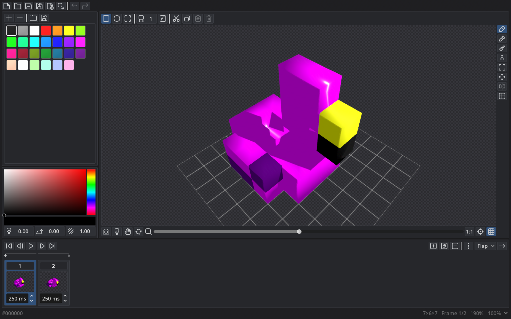

# Leonard's Voxel Editor

Create voxel art and animation.

- [Download for Windows](https://github.com/LeonardMeagher2/LVE/releases/latest/download/LVE-windows-x86_64.zip)
- [Download for Linux](https://github.com/LeonardMeagher2/LVE/releases/latest/download/LVE-linux-x86_64.zip)



LVE is a voxel editor for 3D pixel art and animation.
Paint and sculpt voxels, set per-voxel materials, and animate frames with tags.
Export a low-poly glTF mesh or a sprite sheet.

## Features

- Paint, erase, fill, spray, and pick colors.
- Build, dig, flatten, smooth, and grab terrain.
- Select, move, rotate, and scale voxels.
- Mirror and slice the model while you work.
- Animate frames with tags, loops, and playback.
- Set albedo, metallic, roughness, and emission per voxel.
- Export glTF, GLB, and sprite sheets.
- Save compact `.lve` documents or `.lve.png` files with a preview.

## Document files

- `.lve` is a compact binary document.
- `.lve.png` adds a rendered first-frame preview.
- Open either format to restore the animation and saved settings.
- Share the original PNG file to preserve its document data.

See [docs/DOCUMENT_FORMAT.md](docs/DOCUMENT_FORMAT.md) for the format.

## Agent access

An agent can use the editor through a local MCP server. Click the server icon in the status bar to start or stop it. The app remembers the last state. See [docs/MCP.md](docs/MCP.md) to connect a harness.

## Development

LVE uses Godot 4.7.2. Godot is the only toolchain.

1. Import `project.godot` in Godot 4.7.2.
2. Run the main scene.

### Tests

Run one behavior test:

```text
godot --path . res://tests/paint_strokes.tscn -- paint
```

Run the full suite:

```text
godot --headless --path . -s res://tests/run_all.gd
```

## License

MIT. See [LICENSE](LICENSE).
