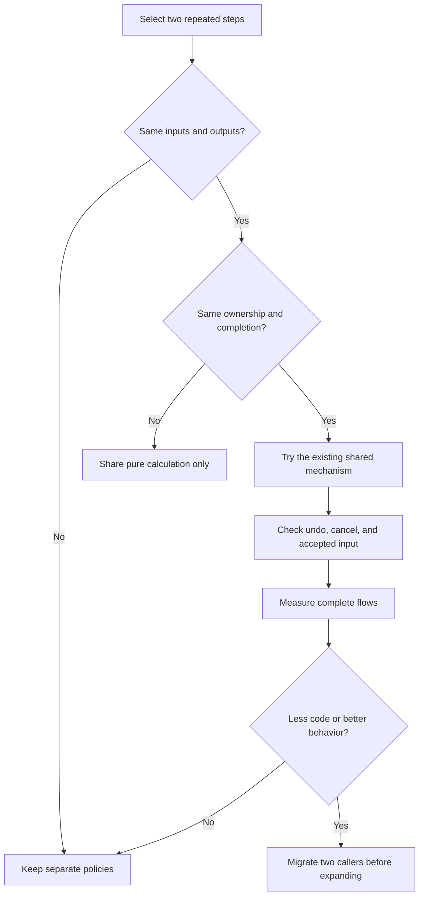

# Compare tool flows

Use the family maps as source evidence for this review.
Some former candidates are now working-tree code migrations.
Treat the remaining candidates as hypotheses, not approved changes.
Static review does not prove a performance gain.

## Compare flow families

Use these groups to find similar steps.
Do not treat the groups as proposed base classes.
Some tools combine more than one flow.

| Flow | Tools | Distinct policy to preserve |
| --- | --- | --- |
| Queued stamps | Brush, Eraser, Paint Brush | Preserve accepted centers and finish pending writes before closing the stroke. |
| Sampling followed by stamps | Spray | Keep hover sampling, accepted sampling, random state, and writes separate. The search counts and ranks occupied rows. |
| Queued surface dabs | Build, Flatten, Smooth | Preserve crossed cells and mode-specific placement, materials, and progress. Flatten and Smooth idle hover uses local FIT then MAP snapshots. Build uses a cheap face or floor ring. |
| Baseline displacement | Grab, Move, Rotate, Scale | Keep baseline snapshots. Preserve each tool's release and commit rules. |
| Cursor preview followed by confirmation | Line, Paste | Keep preview calculations separate from document installation. Line and Paste use `State.run_edit_job`. Paste shares one placement operation. |
| Region search and streamed publication | Fill, Wand | Keep bounded queues, incremental output, and whole-operation rollback. Both use `BatchCursor.apply_slice`. |
| Screen outline followed by selection | Box, Lasso | Preserve shape sampling, view capture timing, and selection combine modes. |
| Utility state changes | Plane, Symmetry, Eyedropper | Preserve different edit, notification, and undo behavior. The Eyedropper returns false from `apply`, so the base pick publishes no cell change. |
| Clipboard preparation commands | Copy, Cut | Keep source capture, clipboard publication, and Cut's document edit distinct. |

Read the family maps for each tool's complete flow.

## Current code mechanisms

- `VoxelFrame.copy_chunks` returns a local subset snapshot. Its consumers are the Spray worker ROI and the Flatten and Smooth hover fit and map.
- `Chunk.occupancy_rows` provides shared immutable row masks and counts per occupancy revision.
- `SprayOccupancyIndex` counts and ranks occupied rows. It has no candidate array and no full reach gather.
- `TerrainTool` uses a separate active Build footprint leaf. It does not predict the next voxels.
- `TerrainPreview` uses two local hover stages for Flatten and Smooth. Build uses a cheap face or floor ring. Grab keeps its source preview and adds no surface read.
- Verification is partial. These are current code mechanisms, not latest guarantees.
- No performance gain or maximum-size Spray claim is made.

## Compare contracts before code

This graph describes a review process, not the current runtime.

## Preserve these differences

| Difference | Current examples | Review implication |
| --- | --- | --- |
| Replaceable output versus accepted input | Flatten and Smooth hover requests versus queued Build, Flatten, and Smooth dabs. Build poses a separate ring. | Do not use hover replacement rules for accepted edits. |
| Absolute target versus accumulated path | Grab keeps the latest pending displacement. Terrain dabs consume crossed cells. | Do not replace every queue with one queue type. |
| Live preview versus cursor preview | Transform restores previews into the live frame. Paste shows a cursor without changing the model. | Keep rollback and publication rules explicit. |
| Gesture end versus commit | Transform release leaves a pending edit. Terrain release drains accepted work before closing. | Do not make release a universal commit event. |
| Shared settings versus captured input | Terrain captures stroke settings. Selection jobs capture options and the previous selection. | Define the capture point for each operation. |
| Calculation complete versus visible output | Edit jobs produce cells. Preview and model meshes have separate installation paths. | Track these completion points separately. |

Evidence:

- [Terrain queue and modes](terrain.md#common-hover-press-and-stroke-queue)
- [Grab displacement](deform.md#grab)
- [Pose bend](deform.md#pose)
- [Transform lifecycle](transform-selection.md#transform-move-rotate-and-scale)
- [Paste placement](transform-selection.md#paste-placement)
- [Selection modes](transform-selection.md#selection-combine-modes)

## Change review order

The order below favors bounded changes with explicit contracts.
It does not establish performance priority.

| Order | Change | Current state | Required proof | Main risk |
| --- | --- | --- | --- | --- |
| 1 | Compare worker ownership and retirement. | Working-tree code. `State.run_edit_job` serves Clipboard and Line. Static review approved. | Preserve cancellation, joins, progress, and stale-result rejection. | A common runner can hide tool-specific completion rules. |
| 2 | Remove duplicate status ownership. | Working-tree code. Paste shares `_placement_operation_id` through two narrow virtual methods. Static review approved. | Keep one coherent status and cancellation path during preparation and placement. | Placement can outlive a single preview request. |
| 3 | Align preview and execution preparation. | Working-tree code. `TerrainPreview.footprint_depth` and separate fit and map watches serve Flatten and Smooth. Build uses a cheap ring. Static review approved. | Match footprints, materials, and bounds across hover and execution. | Matching functions can still receive different lookup depths. |
| 4 | Compare request capture structures. | Working-tree code. Terrain uses `StrokeInputs`. Spray uses `BatchToken`. Static review approved. | Keep each tool's settings capture time and accepted input order. | A common request type can accumulate unrelated fields. |
| 5 | Share small pure rules where contracts match. | Working-tree code. `BatchCursor.apply_slice` serves Fill and Wand. Static review approved. | Preserve selection coverage, alignment, and tool-specific material rules. | A short helper can obscure a meaningful policy difference. |
| 6 | Honor the base `apply` result. | Working-tree code. A false result publishes no cells. Static review approved. | Keep the `Set Material` action and the empty edit. | A cell-writing tool that returns false would stop publishing. |

Use these detailed lists for the remaining hypotheses:

- [Drawing candidates](drawing.md)
- [Terrain candidates](terrain.md#consolidation-and-simplification-candidates)
- [Transform and selection candidates](transform-selection.md#implemented-migrations-and-remaining-candidates)
- [Shared paths and utility candidates](shared-and-utilities.md)

## Questions for each graph

1. Which values remain shared after the input is captured?
2. Which requests can be replaced without losing accepted work?
3. Which thread performs preparation, calculation, adoption, and installation?
4. Which check rejects stale results after a wait?
5. Does cancellation restore output, discard output, or finish accepted work?
6. Does a tool switch commit, cancel, or continue the operation?
7. Can one operation report completion before its output becomes visible?
8. Does a proposed helper remove duplication without hiding policy?

Do not infer speed from fewer graph nodes.
Use [MEMORY.md](../../../MEMORY.md) for measurements and [TASKS.md](../../../TASKS.md) for unresolved work.
