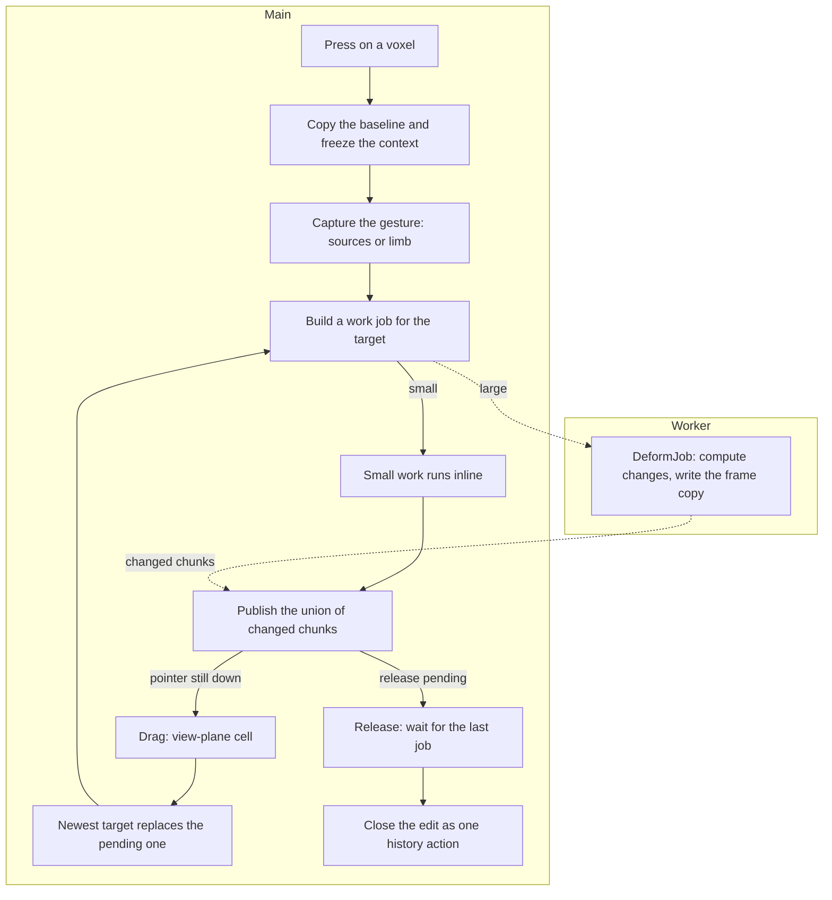
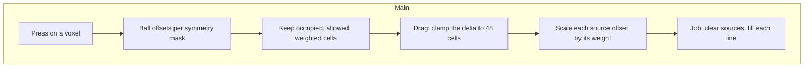
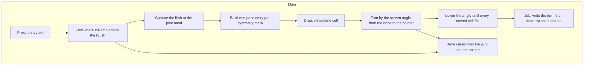

# Deform tool flows

This page shows the current high-level flows of the Deform Grab and Pose tools.
It covers the press capture, the drag queue, the worker map, and the commit.
It cites the current source only.
It does not describe a target design.

Read each graph from top to bottom.
`Main` means the main thread.
`Worker` means the worker pool.

## Terms

- **Baseline**: the frame snapshot that the press copies. Every drag result
  starts from it.
- **Circle**: the one white stepped line mesh named `Footprint`. It lies in the view plane
  at the reach of the active tool and predicts no voxel.
- **Bone**: the one line that Pose draws from the joint to the pointer.
- **Joint**: the point that Pose turns a limb around.
- **Limb**: the connected occupied cells on the near side of the joint.
- **Latest target**: the newest pointer cell. Only it waits for a running job.
- **Published union**: every chunk the drag has written since the press.

## Shared capture, drag, and commit

`VoxelTool` routes a press to `DeformTool._press`.
The press opens one owned edit and copies the frame with `VoxelFrame.copy_frame`.
It freezes the edit context, the selection, the size, and the falloff.
It then builds a view-facing plane through the hit cell and keeps the exact
camera forward.
The capture hook of the tool fills the gesture state.
A capture that finds nothing cancels the edit, so no empty history action
appears.

A drag intersects the captured view plane.
The cell of that point is the newest target.
A running job keeps only the newest target in `_pending_target`.
When the job retires, the tool runs that target.

Each job starts from the baseline copy through `VoxelFrame.job_frame`.
A job writes one frame copy and reports its changed chunks.
The tool publishes the union of the current and every earlier update, because a
chunk that moved in an earlier update must revert when the newest target no
longer covers it.
`State.chunks_changed` then updates the visible surface.

A release sets `_end_requested`.
The stroke closes only when no job runs and no target waits.
`close_stroke` records one history action.
Escape, an edit context change, and a history change call `_cancel_edit`.
That path cancels the job, drops the pending target, and rolls the edit back.

Source:

- [`DeformTool._press`](../../../plugins/Deform/DeformTool.gd)
- [`DeformTool._drag_pointer`](../../../plugins/Deform/DeformTool.gd)
- [`DeformTool._run_job`](../../../plugins/Deform/DeformTool.gd)
- [`DeformTool._finish_job`](../../../plugins/Deform/DeformTool.gd)
- [`DeformTool._settle_release`](../../../plugins/Deform/DeformTool.gd)
- [`DeformTool._cancel_edit`](../../../plugins/Deform/DeformTool.gd)
- [`DeformJob.compute_changes`](../../../plugins/Deform/DeformTool.gd)
- [`VoxelFrame.job_frame`](../../../Globals/State/Document/VoxelFrame.gd)
- [`VoxelFrame.apply_published`](../../../Globals/State/Document/VoxelFrame.gd)
- [`State.run_edit_job`](../../../Globals/State/State.gd)

## Grab

A press captures the occupied cells of a ball of the brush radius around the picked cell.
It does this for every active symmetry mask.
A source must pass the frozen selection, and its falloff weight must be above
zero, because a zero weight cannot move.
The capture stores the full material of each source.

A drag clamps its delta to `GRAB_MAX_DISTANCE`.
Each source moves by its own mirrored offset scaled by its weight.
The newest target wins, so a return to the origin republishes the baseline and
records no history action.

`GrabJob` starts from the baseline copy.
It clears the moved sources and writes each source material along the line to
its destination.
A destination must not hold unrelated geometry.
A destination may leave the selection, so a small selection still moves.
The job sorts the moves by weight, then by the canonical cell, so overlapping
destinations resolve the same way on every run.

The tool poses the circle in the view plane. It shows the brush footprint, and a joint outside it is legal.
Grab draws no bone.

Source:

- [`GrabTool._capture_gesture`](../../../plugins/Deform/GrabTool.gd)
- [`GrabTool._make_job`](../../../plugins/Deform/GrabTool.gd)
- [`GrabTool.GrabJob.compute_changes`](../../../plugins/Deform/GrabTool.gd)
- [`GrabTool.GRAB_MAX_DISTANCE`](../../../plugins/Deform/GrabTool.gd)
- [`TerrainGeometry.weight_at`](../../../plugins/Terrain/TerrainGeometry.gd)

## Pose

The behaviour follows the [Pose brush spec](../research/tools/pose-brush-spec.md).

The bone runs from the joint to the pointer, so a limb that lies across the
view bends in the view plane.
`DeformLimb.joint_pivot` reads no cell axis and no face normal.
The entered face has no effect on the bend.

The joint is the farthest occupied cell within the brush radius. The walk visits empty cells too, so a gap does not hide a cell. A tie prefers the cell on the view plane of the press.
The connected option limits the walk to occupied cells.
It does not walk back, so the base is the limb root and not a cell under the
pointer.
The bound keeps the walk local, so a connected model cannot send the search
across the whole frame.
The joint is therefore always an occupied voxel on the limb, and the pointer is
the tip of the bone.

The moved cells are the connected occupied cells from the picked cell.
The walk stops where the limb crosses the joint band, so the cells behind the
joint keep still.
The walk also stops at the limb allowance, so a solid blob bends a bounded set.
The falloff sets the half width of the joint neck, in cells.
It ramps from half a cell at zero to two cells at one, and stops at
`DeformLimb.NECK_LIMIT`.
A wider neck would shear the whole limb, so the cap keeps the turn rigid.

A drag turns the limb around the view normal, so the bend stays in the view
plane.
The arm runs from the joint to the pointer, and the angle is the screen angle
from the bone to that arm.
The tip therefore lands under the pointer, and no other rule can move it there.
The only limit is the fit, so no angle option caps the stroke.
A bone that points at the viewer has no screen direction, so the bend becomes a
twist by the pointer travel. A mirrored mask turns the other way.

The cell selection limits the limb search and the captured cells, like the
transform tools: an empty selection allows every cell.
The moved cells may leave the selection, so a small selection can still bend.
The selection then moves with the drag.
A selected cell that stays keeps its place, a cell that the drag empties leaves,
and every cell that the drag writes joins.
A drag that returns to its first position republishes the baseline and restores
the press selection, so the next stroke acts on the cells that the artist sees.

One magnitude serves every mask.
`PoseTool._fit_angle` lowers it until every moved cell passes the slice, the
document size, and the written geometry.
An obstacle on one side therefore limits both sides, and a symmetric pair always
moves together.
A press whose angle cannot fit starts no stroke.

The job writes the turned cells first.
It then clears a source cell only when a pose wrote the cell that this source
turned onto.
A destination that holds an unrelated cell refuses its write, so the source
stays in place and the limb never loses a cell.
When two sources land on one cell, the source farther from the joint keeps its
material.
An inverse map walks the box around the turned limb and maps each destination
back through the inverse rotation.
A second pass writes the turned cell of every source that the inverse map missed.
That pass writes one cell per source, so it closes a gap without drawing a line.
A turn therefore adds no cell and leaves no ghost, and the limb never smears
along the arc.

The bone is the whole cursor.
A hover shows the joint and the bone to the cell under the pointer.
The hover reads one captured cell only, because it answers one question: can the
press capture a cell?
The scan runs again only when the picked cell, the size, the falloff, the
selection, the slice, the document size, or the frame changes.

Source:

- [`DeformLimb.joint_pivot`](../../../plugins/Deform/DeformLimb.gd)
- [`DeformLimb.capture_limb`](../../../plugins/Deform/DeformLimb.gd)
- [`DeformLimb.turn_point`](../../../plugins/Deform/DeformLimb.gd)
- [`PoseTool._capture_gesture`](../../../plugins/Deform/PoseTool.gd)
- [`PoseTool._make_job`](../../../plugins/Deform/PoseTool.gd)
- [`PoseTool._fit_angle`](../../../plugins/Deform/PoseTool.gd)
- [`PoseTool.PoseJob._pose`](../../../plugins/Deform/PoseTool.gd)
- [`PoseTool.PoseJob._release_replaced`](../../../plugins/Deform/PoseTool.gd)
- [`PoseTool._pose_bone`](../../../plugins/Deform/PoseTool.gd)

## Options and registration

`DeformPlugin` owns the two tools, one `MenuButton`, and one option bar.
`State.reset_plugins` adds it after the terrain plugin.
The toolbar holds Grab and Pose with fixed ids.
The option bar shows the shared size and falloff, and the pose Connected option.
Neither tool shows a strength control, because neither uses one.

Source:

- [`DeformPlugin`](../../../plugins/Deform/DeformPlugin.gd)
- [`Deform/Toolbar.gd`](../../../plugins/Deform/Toolbar.gd)
- [`Deform/Options.gd`](../../../plugins/Deform/Options.gd)
- [`State.reset_plugins`](../../../Globals/State/State.gd)

## Current limits and non-claims

- The size setting clamps to 1 through 32. Both tools share the bound.
- Grab uses a drag limit of 48 cells.
- Pose draws its bone on every hover and through the drag.
- Pose turns around the view normal only. It cannot turn out of the view plane.
- A limb walk stops at 8192 cells, so a bend stays inside the brush bound. A
  hover reads one cell of the limb.
- The joint search reads at most 2048 cells of the brush ball, occupied or not.
- A bend lowers its angle until every moved cell fits. It never splits a
  symmetric pair.
- The joint share comes from the joint neck. It is not a
  skin weight, so a sharp joint can pinch the inner side.
- A turn resamples cells, so a thin limb can lose a cell at a sharp corner.
- The angle has no option cap. The fit is the only limit, so a destination that
  does not fit lowers the bend.
- This page does not assert a performance result.
