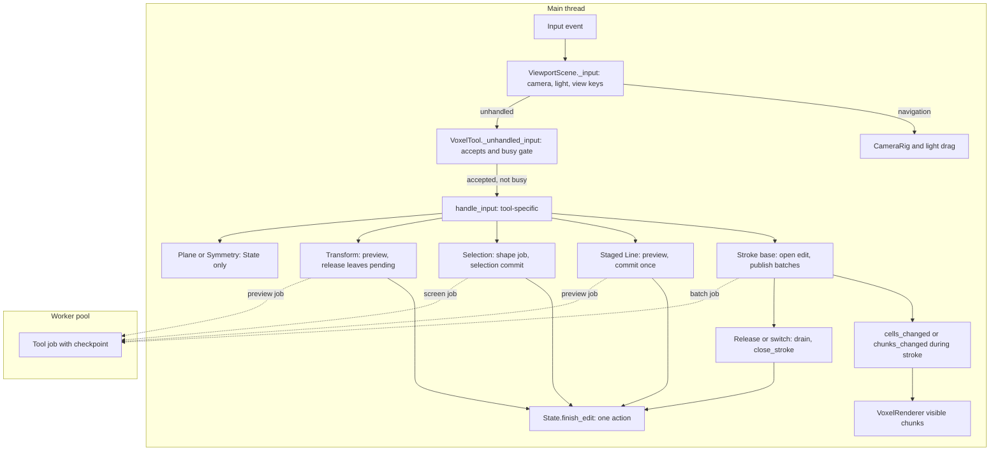
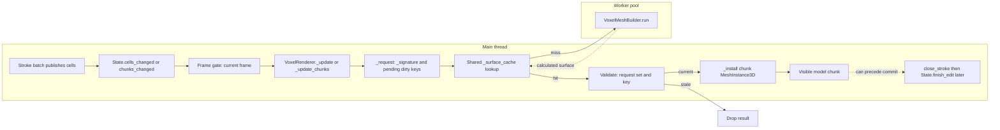
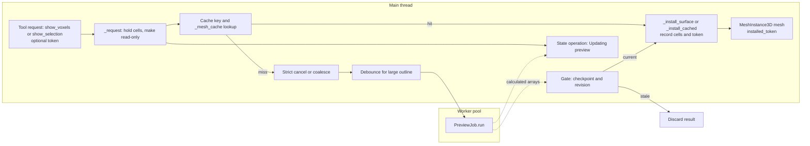
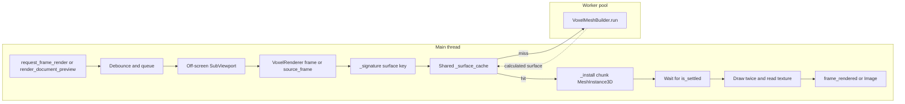
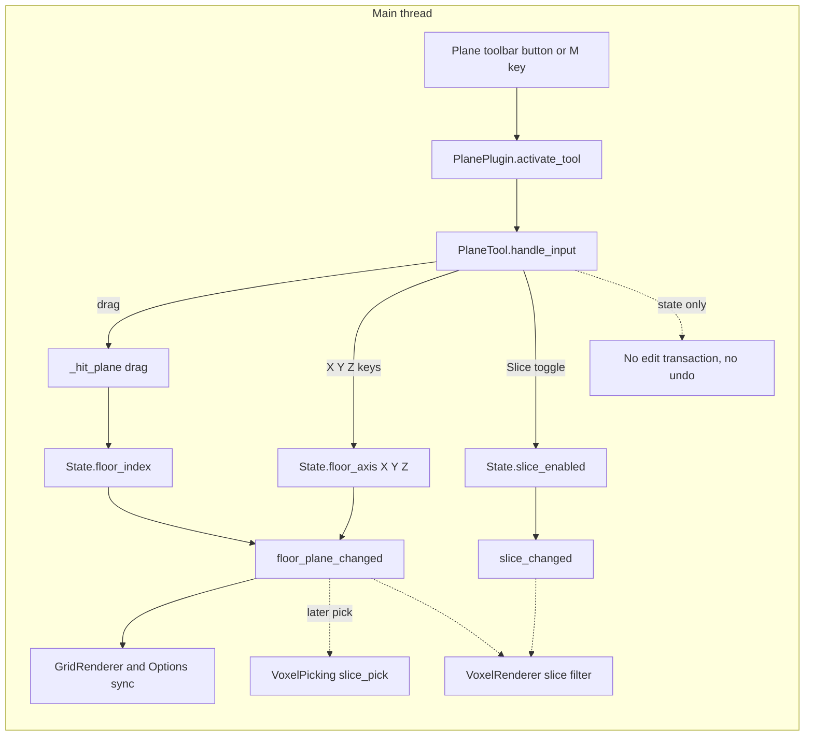
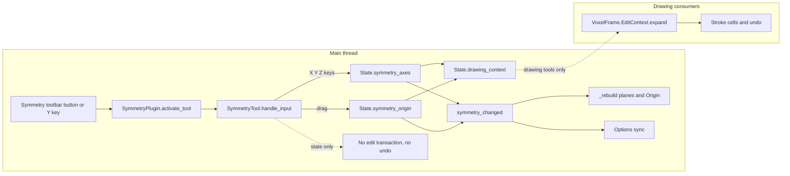
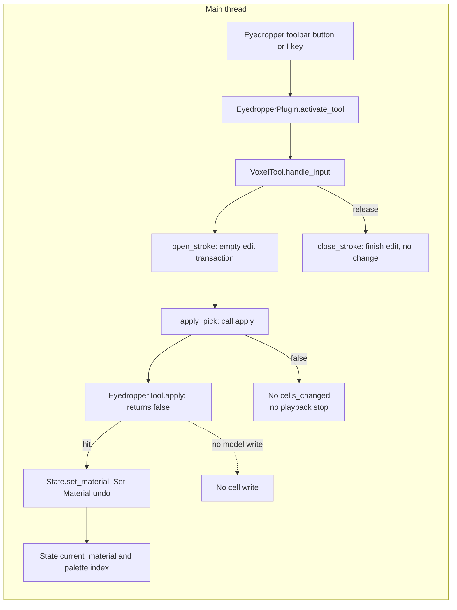

# Shared tool infrastructure and utility tools

This page maps the shared tool path and three utility tools.
It describes current code.
A short note names one roadmap tool that is not current.
The paths are relative to this file.
The verification history is in the composition guide.

The shared path covers plugin registration, pointer input, edit ownership, worker jobs, and preview meshes.
It also covers visible model renders and optional image renders.
The utility tools are Plane, Symmetry, and Eyedropper.

## Diagram vocabulary

Use these words with the same meaning in every diagram.

| Word | Meaning |
| --- | --- |
| `Main` | Code that runs on the main thread. It can touch Nodes, `State`, and `UndoRedo`. |
| `Worker` | Code that runs on `WorkerThreadPool`. It reads captured data and writes its own arrays. It must not touch scene Nodes or change shared state. |
| Captured request | Input captured for one operation. The operation must not change it. Only some containers are read-only. Examples are read-only `_requested_cells`, owned `job.centers`, and the frozen `tx.edit_context` reference. |
| Shared settings | A value or Resource that many operations read. Examples are the `settings.tres` Resource and the `State.current_material` value. |
| Released | The input is finished. The result can still be calculated. |
| Calculated | The worker body returned. The result is not visible yet. |
| Published | A calculated batch is written into the live frame. It can be visible before the final commit. |
| Committed | The edit is written and one history action records it. |
| Installed | The visible result is applied to the scene. |
| Rejected | The result failed a gate and is discarded. |
| Edit transaction | A `VoxelEditTransaction`. It captures start snapshots and supplies one history action when it finishes. |
| Undo scope | The changes that one history action restores. |
| Preview pipeline | `VoxelPreview` builds an interactive cursor or selection mesh. |
| Document render pipeline | `VoxelRenderer` builds visible model chunks. `VoxelImageRenderer` optionally renders off-screen images. |
| State-only | A tool changes `State` but not frame cells. Plane and Symmetry are state-only. Eyedropper changes the current material and records one material undo action. It returns `false` from `apply`, so the base pick publishes no cell change. |

## Registration inventory

`State._ready` adds eleven plugins in a fixed order.
The toolbar follows the plugin order for the eight toolbar plugins.
The toolbar order is Brush, Eyedropper, Paint, Terrain, Selection, Transform, Symmetry, and Plane.
The source is [`State.gd:252`](../../../Globals/State/State.gd#L252).

| Plugin | UI registration | Options | Tool node | Start state |
| --- | --- | --- | --- | --- |
| `BrushPlugin` | `plugins/brush/Toolbar.tscn`, a `MenuButton` with Pencil, Line, and Eraser | `plugins/brush/Options.tscn` | `BrushTool.tscn` and `LineTool.tscn` | Active at startup |
| `EyedropperPlugin` | `plugins/Eyedropper/Toolbar.tscn`, a `Button` | None | `EyedropperTool.tscn` | Inactive |
| `PaintPlugin` | `plugins/paint/Toolbar.tscn`, a `MenuButton` with Paintbrush, Bucket Fill, and Spray Can | `plugins/paint/Options.tscn` | `PaintBrushTool.tscn`, `FillTool.tscn`, and `SprayTool.tscn` | Inactive |
| `TerrainPlugin` | `plugins/Terrain/Toolbar.tscn`, a `MenuButton` with Build, Flatten, and Smooth | `plugins/Terrain/Options.tscn` | `TerrainTool.tscn` | Inactive |
| `DeformPlugin` | `plugins/Deform/Toolbar.tscn`, a `MenuButton` with Grab and Pose | `plugins/Deform/Options.tscn` | `GrabTool.tscn` or `PoseTool.tscn` | Inactive |
| `SelectionPlugin` | `plugins/selection/Toolbar.tscn`, a `MenuButton` with Box, Wand, and Lasso | `plugins/selection/Options.tscn` | `BoxSelectTool.tscn`, `WandSelectTool.tscn`, and `LassoSelectTool.tscn` | Inactive |
| `TransformPlugin` | `plugins/Transform/Toolbar.tscn`, a `MenuButton` with Move, Rotate, and Scale | `plugins/Transform/Options.tscn` | `MoveTool.tscn`, `RotateTool.tscn`, and `ScaleTool.tscn` | Inactive |
| `SymmetryPlugin` | `plugins/Symmetry/Toolbar.tscn`, a `Button` | `plugins/Symmetry/Options.tscn` | `SymmetryTool.tscn` | Tool mounted, `active` false |
| `PlanePlugin` | `plugins/Plane/Toolbar.tscn`, a `Button` | `plugins/Plane/Options.tscn` | `PlaneTool.tscn` | Tool mounted only while active |
| `ExportPlugin` | `plugins/Export/MenuBarItem.tscn`, a menu bar item | Export workspace controls | Own `VoxelRenderer` nodes | Workspace tab added |
| `ClipboardPlugin` | No own toolbar button | `plugins/Clipboard/Options.tscn` | `PasteTool.tscn` on demand | Inactive |
| `ImageImportPlugin` | No toolbar and no menu item | None | None | Called from the file open path |

The plugin base class supplies the registration helpers.
The helpers are `add_tool_bar_item`, `add_option_bar_item`, `add_editor_node`, `add_menu_bar_item`, and `add_tab`.
The source is [`VoxelPlugin.gd`](../../../VoxelPlugin.gd).

### Input actions

`project.godot` defines these tool actions.

| Action | Key | Consumer |
| --- | --- | --- |
| `tool_pencil` | B | `plugins/brush/Toolbar.gd` |
| `tool_line` | L | `plugins/brush/Toolbar.gd` |
| `tool_eraser` | E | `plugins/brush/Toolbar.gd` |
| `tool_eyedropper` | I | `plugins/Eyedropper/Toolbar.tscn` |
| `tool_paint` | P | `plugins/paint/Toolbar.gd` |
| `tool_fill` | F | `plugins/paint/Toolbar.gd` |
| `tool_spray` | T | `plugins/paint/Toolbar.gd` |
| `tool_select` | Q | `plugins/selection/Toolbar.gd` |
| `tool_wand` | W | `plugins/selection/Toolbar.gd` |
| `tool_lasso` | A | `plugins/selection/Toolbar.gd` |
| `tool_move` | G | `plugins/Transform/Toolbar.gd` |
| `tool_rotate` | R | `plugins/Transform/Toolbar.gd` |
| `tool_scale` | S | `plugins/Transform/Toolbar.gd` |
| `tool_symmetry` | Y | `plugins/Symmetry/Toolbar.tscn` |
| `tool_plane` | M | `plugins/Plane/Toolbar.tscn` |

`ToolMenuButton._shortcut_input` selects a mode and calls `accept_event`.
The source is [`ToolMenuButton.gd:21`](../../../plugins/ToolMenuButton.gd#L21).

### Registration gaps

These gaps are visible in the current registrations.

- `TerrainPlugin` has no `tool_terrain` action. The sculpt menu has no keyboard shortcut.
- `ImageImportPlugin` has no direct toolbar or menu item. `MenuBar.open_document` calls `import_image` for image extensions.
- `ClipboardPlugin._sync_options` attaches its controls only to Brush, Paint, Selection, and Transform option bars. The controls are absent while Terrain, Plane, Symmetry, or Eyedropper is active.
- `EyedropperPlugin` has no option bar.
- `PlanePlugin` mounts its tool only while active. `SymmetryPlugin` mounts its tool at startup and toggles `active`.

### Not current

The roadmap lists an Extrude tool.
Current code has no Extrude plugin, toolbar item, option bar, or tool node.
This page does not map it.

## Common input spine

The editor viewport handles navigation before a tool sees the event.
`ViewportScene._input` handles the camera, the light handle, and the view drags.
The source is [`Viewport.gd:310`](../../../ui/Viewport/Viewport.gd#L310).

`VoxelTool._unhandled_input` rejects events that `_accepts` does not allow.
The base `_accepts` allows mouse buttons, mouse motion, and keys.
A busy gate consumes the event and stops the path.
The source is [`VoxelTool.gd`](../../../Globals/State/Tools/VoxelTool.gd) and [`VoxelTool.gd`](../../../Globals/State/Tools/VoxelTool.gd).

The event gate is common.
The lifecycle after `handle_input` is tool-specific.
The graph names representative flows.
It does not define one universal order.

| Flow | Edit start | Visible change | Commit | Switch |
| --- | --- | --- | --- | --- |
| Stroke base | `open_stroke` on press | Batch `StrokeTool._finish_edit` publishes cells and emits `chunks_changed`. `_flush_cells` emits `cells_changed` | `close_stroke` after the final batch calls `State.finish_edit` | `finish_on_switch` drains and commits |
| Staged Line | No edit until commit | `LineTool` preview job on a frame snapshot | `_commit_line` calls `State.begin_edit`, publishes the changed chunks, then `State.finish_edit("Line")` | `_cancel_edit` discards the preview |
| Selection | `open_stroke` on press. The release closes it empty. `_finish_screen_selection` opens a new edit | `ScreenSelection.Job` builds the selection | `State.finish_edit("Screen selection")` | `finish_on_switch` applies the held outline |
| Transform | `open_stroke` on press | Preview publishes its changed chunks into the live frame | Enter `_commit` calls `_end`, then `State.finish_edit` | `_exit_tree` calls `_commit` |
| Plane or Symmetry | None | `State` fields only | No undo action | Tool-specific |

The base `VoxelTool.handle_input` starts a stroke only on the left mouse button.
A press calls `open_stroke` before the pick.
A failed pick calls `abort_stroke`.
The base path is the stroke example.
It is not the path for every tool.
The source is [`VoxelTool.gd`](../../../Globals/State/Tools/VoxelTool.gd).

### Accepted input scope

The camera claims these events before the tools.

| Event | Handler | Effect | Reaches tool |
| --- | --- | --- | --- |
| Left press, no modifier, no view toggle, no light handle | `VoxelTool` | Tool action | Yes |
| Left press with Alt | `ViewportScene._input` | Orbit | No |
| Left press with Shift | `ViewportScene._input` | Pan | No |
| Left press with Pan or Rotate toggle on | `ViewportScene._input` | Pan or orbit | No |
| Right press or drag | `ViewportScene._input` | Orbit | No |
| Middle press or drag | `ViewportScene._input` | Pan | No |
| Shift plus right drag | `ViewportScene._input` | Pan | No |
| Mouse wheel | `ViewportScene._input` | Zoom | No |
| Left press on the light handle | `ViewportScene._input` | Light drag | No |
| View preset key | `ViewportScene._unhandled_key_input` | Set view | No |
| Escape | `State._input` | Cancel a foreground operation | Only when no operation owns Escape |

The drag decision is in [`Viewport.gd:282`](../../../ui/Viewport/Viewport.gd#L282).
The light drag is in [`Viewport.gd:209`](../../../ui/Viewport/Viewport.gd#L209).
The camera moves are in [`CameraRig.gd:140`](../../../ui/Viewport/CameraRig.gd#L140) and [`CameraRig.gd:147`](../../../ui/Viewport/CameraRig.gd#L147).

### Release, calculated, published, committed, installed

These words name different moments in one operation.

| Stage | Meaning | Stroke example | Preview example | Renderer example |
| --- | --- | --- | --- | --- |
| Released | The input is finished. The request stops growing. | `_end` sets `_end_requested` | Not applicable. A newer request or a clear replaces it. | Not applicable. The render request has no pointer input. |
| Calculated | The worker body returned. The result is not visible. | `BrushJob.run` fills `cell_materials` | `PreviewJob.run` fills `arrays` | `VoxelMeshBuilder.run` fills `surface_arrays` |
| Published | A batch is written into the live frame. It can be visible before commit. | `StrokeTool._finish_edit` publishes the batch changed chunks. A batch does not commit. | Not applicable | Not applicable |
| Committed | The edit is written and one history action records it. | `close_stroke` after the final batch calls `State.finish_edit`. | Not applicable | Not applicable |
| Installed | The visible result is applied. | Not applicable | `_install_surface` sets `mesh` | `_install` sets the chunk `MeshInstance3D` |
| Rejected | A gate discards the result. | `checkpoint(0)` is false | Revision or epoch mismatch | In-flight key was cleared |

The stroke batch publish is in [`StrokeTool.gd`](../../../plugins/brush/StrokeTool.gd).
`StrokeTool._finish_edit` does not call `State.finish_edit`.
The stroke commit is in [`StrokeTool.gd`](../../../plugins/brush/StrokeTool.gd) and [`State.gd:563`](../../../Globals/State/State.gd#L563).
The preview gate is in [`VoxelPreview.gd`](../../../Globals/Rendering/VoxelPreview.gd).
The renderer install is in [`VoxelRenderer.gd:499`](../../../ui/Viewport/VoxelRenderer.gd#L499).

### Captured requests and shared settings

Shared settings can change during an operation.
The operation must keep the values it needs and must not depend on later shared changes.

| Item | Lifetime | Owner | Evidence |
| --- | --- | --- | --- |
| `settings.tres` | Whole session | Tool plugin and options | `BrushPlugin._settings` at [`BrushPlugin.gd:13`](../../../plugins/brush/BrushPlugin.gd#L13) |
| Stroke diameter, shape, and mode | One stroke | `StrokeTool` | `_stroke_diameter` and `_stroke_shape` at [`StrokeTool.gd`](../../../plugins/brush/StrokeTool.gd) |
| Stroke material pattern | One stroke | `StrokeTool` | `_stroke_material` and `_stroke_material_pattern` at [`StrokeTool.gd`](../../../plugins/brush/StrokeTool.gd) |
| Edit context | One edit | `VoxelEditTransaction` | `edit_context` at [`VoxelEditTransaction.gd:22`](../../../Globals/State/VoxelEditTransaction.gd#L22) |
| Frame snapshot | One job | `BrushJob` | `edited_frame` at [`StrokeTool.gd`](../../../plugins/brush/StrokeTool.gd) |
| Requested preview cells | One request | `VoxelPreview` | `_requested_cells` at [`VoxelPreview.gd`](../../../Globals/Rendering/VoxelPreview.gd) |
| Prepared solid payload | One submit | `SolidPayload` | `spots` at [`VoxelPreview.gd`](../../../Globals/Rendering/VoxelPreview.gd) |
| Document preview frame | One render | `VoxelImageRenderer` | `copy_frame` at [`VoxelImageRenderer.gd:172`](../../../Globals/VoxelImageRenderer/VoxelImageRenderer.gd#L172) |

`job.centers` is an owned array, not a read-only container.
`_requested_cells` and `SolidPayload.spots` are made read-only.
`StrokeTool.open_stroke` copies the mode, the diameter, the material, and the material pattern at the start.
The jobs use those captured values.
The first stamp reads `_settings.pattern()`, so the pattern cache stays a shared setting.
A mode change ends the stroke through the plugin.
The source is [`StrokeTool.gd`](../../../plugins/brush/StrokeTool.gd).

`VoxelPreview._request` keeps a read-only cell set.
It duplicates the cells when the input is not already read-only.
The source is [`VoxelPreview.gd`](../../../Globals/Rendering/VoxelPreview.gd).

### Local frame snapshots and occupancy rows

`VoxelFrame.copy_chunks(locations)` returns a frame with selected present chunks.
It keeps the same chunk objects and marks the source chunks shared before the subset is exposed.
Existing shared entries stay shared, so an older full or subset snapshot stays frozen.
It does not copy the whole chunk dictionary. The cost follows the requested locations.
Its consumers are the Spray worker ROI and the Flatten and Smooth hover fit and map snapshots.
The source is [`VoxelFrame.copy_chunks`](../../../Globals/State/Document/VoxelFrame.gd).

`Chunk.occupancy_rows()` builds lazy immutable row masks and counts per `occupancy_revision`.
A material-only write keeps the revision, so the rows survive a repaint.
A copy-on-write copy shares the rows. A snapshot restore keeps them correct.
The source is [`Chunk.occupancy_rows`](../../../Globals/State/Document/VoxelFrame.gd).

`VoxelFrame.get_bounds()` caches between API writes.
A cache hit checks the raw chunk count. A raw change that keeps the count must call `invalidate_bounds()`.
`invalidate_bounds()` repairs the bounds only. It does not repair a raw grid write or copy-on-write metadata.
The cache adds metadata only. The storage version and model transparency do not change.
The sources are [`VoxelFrame.get_bounds`](../../../Globals/State/Document/VoxelFrame.gd) and [`VoxelFrame.invalidate_bounds`](../../../Globals/State/Document/VoxelFrame.gd).

### Worker cancellation and undo scope

`VoxelFrame.EditJob.cancel` sets a flag.
`checkpoint` reads the flag and returns false.
The worker body must call `checkpoint` often.
The source is [`VoxelFrame.gd`](../../../Globals/State/Document/VoxelFrame.gd).

`State.run_edit_job` starts the worker, pumps progress, and joins the worker before it returns.
It calls `on_frame` before each progress update.
The runner joins exactly once.
A caller that waits itself retires the task id, so the runner stops without a second wait.
The source is [`State.gd:492`](../../../Globals/State/State.gd#L492).

| Path | Cancel source | Join | Result gate | Undo scope |
| --- | --- | --- | --- | --- |
| Brush and Spray stroke | Escape, context change, history change | `wait_for_worker` in the runner or teardown | `checkpoint(0)` and document and frame identity | One `Stroke` or `Erase` action |
| Staged Line | Escape, context, selection, floor, cell, or chunk change. A switch also cancels | `State.run_edit_job` join | Revision and anchor for preview. Document and frame identity at commit | One `Line` action on commit |
| Selection | Escape or context change | Screen job wait | Checkpoint and identity | One `Screen selection` action |
| Erase selection | `edit_context_changing` | `State.run_edit_job` | Document and frame identity | One `Erase Selection` action |
| Clipboard copy or cut | Document or frame change through the `on_frame` callback | `State.run_edit_job` join, exactly once | Document, frame, and `checkpoint(0)` | Cut records `Cut`. Copy records no undo |
| Clipboard paste | Escape, context, document, frame, selection, floor, cell, or chunk change. A tool toggle also cancels | `State.run_edit_job` join for import and preview, exactly once | Revision and anchor for preview. Document and frame identity at commit | One `Paste` action |
| Image import | Document or frame change | `State.run_edit_job` | Document and frame identity | New document resets history |
| Preview | Strict request or clear | `wait_for_task_completion` | Revision or stream epoch | No undo |
| Renderer | No cancel | Last renderer joins all tasks | In-flight key and request set | No undo |
| Plane and Symmetry | No worker | Not applicable | Not applicable | No undo |
| Eyedropper | No worker | Not applicable | Empty edit closes with no change. `apply` returns `false`, so no cell change | One `Set Material` action |

`State.begin_edit` allows one active edit.
A second call returns null.
The source is [`State.gd:542`](../../../Globals/State/State.gd#L542).

`State.finish_edit` records one history action when the transaction changed.
`State.cancel_edit` restores the start snapshots and records no action.
The source is [`State.gd:563`](../../../Globals/State/State.gd#L563) and [`State.gd:581`](../../../Globals/State/State.gd#L581).

`VoxelEditTransaction.finish` compares the start and end snapshots.
It returns null when the frame and the selection did not change.
The source is [`VoxelEditTransaction.gd:83`](../../../Globals/State/VoxelEditTransaction.gd#L83).

## Model and output paths

The editor has three render paths.
The visible model path is primary.
The visible model path does not depend on `VoxelImageRenderer`.
`VoxelRenderer` builds visible chunk meshes in the editor viewport.
`VoxelPreview` builds the cursor and selection preview.
`VoxelImageRenderer` optionally reads an off-screen `VoxelRenderer`.
The solid paths use `VoxelMeshBuilder` and `VoxelAtlas`.
`VoxelPreview` has its own mesh cache and job.
`VoxelRenderer` instances share one static surface cache and one job map.

### Visible model render

`VoxelRenderer._enter_tree` connects `State.cells_changed` to `_update` and `State.chunks_changed` to `_update_chunks`.
`_update` and `_update_chunks` filter on the current frame.
`_update` marks the affected chunks and their crosstalk neighbors.
`_request` computes the signature and stores the pending surface key.
`_update_surfaces` consumes cached surfaces or launches `VoxelMeshBuilder` jobs.
`_install` sets the chunk `MeshInstance3D` mesh.
A stroke batch can install visible chunks before the final commit.
The renderer can install an intermediate chunk mesh while a batch is published.
`close_stroke` commits later.
The sources are [`VoxelRenderer.gd:93`](../../../ui/Viewport/VoxelRenderer.gd#L93), [`VoxelRenderer.gd:167`](../../../ui/Viewport/VoxelRenderer.gd#L167), and [`VoxelRenderer.gd:499`](../../../ui/Viewport/VoxelRenderer.gd#L499).
The request and build sources are [`VoxelRenderer.gd:186`](../../../ui/Viewport/VoxelRenderer.gd#L186), [`VoxelRenderer.gd:208`](../../../ui/Viewport/VoxelRenderer.gd#L208), and [`VoxelRenderer.gd:255`](../../../ui/Viewport/VoxelRenderer.gd#L255).

The off-screen `VoxelRenderer` uses the same static `_surface_cache` and `_surface_jobs`.
The key includes the smooth setting, the neighbor chunk instance ids, and the neighbor voxel revisions.
The cache and job sources are [`VoxelRenderer.gd:22`](../../../ui/Viewport/VoxelRenderer.gd#L22) and [`VoxelRenderer.gd:365`](../../../ui/Viewport/VoxelRenderer.gd#L365).

### Interactive preview

`VoxelPreview` is a `MeshInstance3D` in the editor viewport.
It builds a cursor or selection mesh from a captured cell set.
A strict request cancels the running job.
A coalescing request keeps the running job and installs a completed snapshot in request order.
Preview consumers are `BrushPreview`, `LineTool`, `PasteTool`, `SprayTool`, `TerrainTool`, and `SelectionPlugin`.
The source is [`VoxelPreview.gd`](../../../Globals/Rendering/VoxelPreview.gd).

The cache limit is 64 MB and 16 entries.
The source is [`VoxelPreview.gd`](../../../Globals/Rendering/VoxelPreview.gd).

A selection outline reads dense masks, not the cell dictionary.
`VoxelSelection.mask_chunks` holds one 16-bit row per chunk row and edge axis.
Every selection mutation keeps the masks current.
A worker gets `mask_snapshot`, so it never reads the live selection.
The snapshot copies the chunk dictionary, each three-grid entry, and each grid.
A packed array that two array elements share does not detach on a write, so a shared grid is not safe.
A chunk entry also holds the chunk cell count. A chunk that reaches zero leaves the mask set.
A box fills its masks in row runs. A streamed batch groups its cells by chunk and writes each grid once.
The outline builder reads the cell row, the two side rows, and the diagonal row of one line.
A side or diagonal cell on a chunk border comes from the neighbor chunk mask.
The source is [`VoxelSelection.gd`](../../../Globals/State/VoxelSelection.gd) and [`VoxelPreview.gd`](../../../Globals/Rendering/VoxelPreview.gd).

An edit transaction captures the selection masks with the selection.
`VoxelEditTransaction` stores them in the undo change, and `State._restore_chunks` passes them to `restore`.
An undo or redo then installs the recorded grids, so it does not rebuild them.
A completed streamed selection holds the result masks already, so the wand finish does not restore them again.
The finish publishes through the progressive outline path.
A strict request there would cancel the running stream and rebuild the same outline.
The source is [`VoxelEditTransaction.gd`](../../../Globals/State/VoxelEditTransaction.gd) and [`WandSelectTool.gd`](../../../plugins/selection/tools/WandSelectTool.gd).

`show_voxels` and `_request` accept an optional opaque token.
`SolidPayload.token` and `PreviewJob.token` carry it.
The caller owns the token and captures it before submit. Do not mutate it while a job is in flight or a surface is installed.
`installed_token()` reports the token of the installed surface.
A cache hit reports the token of the request that asked for the hit, not the mesh key. Caches do not clone the payload token.
Other callers leave the token null.

The progressive selection path uses `_stream_epoch`.
A clear or a strict request increments the epoch.
An old stream result cannot install after the epoch changes.
The source is [`VoxelPreview.gd`](../../../Globals/Rendering/VoxelPreview.gd).

### Offscreen image consumer

`VoxelImageRenderer` is optional.
It owns a hidden `SubViewport` with a `VoxelRenderer`.
It debounces frame requests and renders one frame at a time.
It waits for `VoxelRenderer.is_settled` before it draws.
Off-screen consumers are `AnimationFrame`, `MenuBar`, and `ExportPlugin`.
The source is [`VoxelImageRenderer.gd:60`](../../../Globals/VoxelImageRenderer/VoxelImageRenderer.gd#L60).

`VoxelRenderer` shares one surface cache and one job map across every renderer.
The cache limit is 64 MB and 1024 entries.
The off-screen renderer uses the same chunk build and cache code as the visible renderer.
Its `source_frame` can be a copy, so cache keys can differ.
The source is [`VoxelRenderer.gd:22`](../../../ui/Viewport/VoxelRenderer.gd#L22).

A renderer does not cancel a running surface job on a rebuild.
It clears the in-flight keys, so a result from the old context cannot install.
The source is [`VoxelRenderer.gd:145`](../../../ui/Viewport/VoxelRenderer.gd#L145).

`render_document_preview` uses a temporary viewport and a copied first frame.
It returns null in a headless run or when the document changes.
The source is [`VoxelImageRenderer.gd:165`](../../../Globals/VoxelImageRenderer/VoxelImageRenderer.gd#L165).

## Utility tools

Plane, Symmetry, and Eyedropper are utility tools.
They change no frame cells.
They differ in their `State` effects and their undo behavior.

### Plane

The Plane tool moves the floor plane.
A drag sets `State.floor_index`.
The X, Y, and Z keys set `State.floor_axis`.
The option bar has a Slice toggle.
The source is [`PlaneTool.gd:36`](../../../plugins/Plane/PlaneTool.gd#L36).

The slice limits every edit to the floor layer.
The layer is cell index `State.floor_index`, the layer above the grid line.
The edit context freezes the axis and the index at begin.
One write gate applies the limit. See [Write scope](#write-scope).
The view also draws only the slice layer while the option is on.
The source is [`VoxelRenderer.gd:63`](../../../ui/Viewport/VoxelRenderer.gd#L63).

The plane tool overrides `handle_input`.
It does not call `open_stroke`.
It does not write cells and it does not add an undo action.
The source is [`PlaneTool.gd:36`](../../../plugins/Plane/PlaneTool.gd#L36).

The grid follows `floor_plane_changed`.
The source is [`GridRenderer.gd:18`](../../../ui/Viewport/GridRenderer.gd#L18).

The floor pick uses `State.floor_axis` and `State.floor_index`.
A slice pick meets the slice plane, so a voxel on another layer cannot block it.
The source is [`VoxelPicking.gd:28`](../../../Globals/State/Tools/VoxelPicking.gd#L28).

#### Write scope

`EditContext` holds the symmetry, the selection, the floor slice, and the centered document size.
`State._live_context` fills it, and `State.begin_edit` freezes it.
[`VoxelFrame.set_cells`](../../../Globals/State/Document/VoxelFrame.gd) is the one write gate.
It applies `EditContext.filter` when the job carries a context.
A document load, an import, and a history restore pass no job, so they are never limited.
A new writable-cell rule is one predicate in `EditContext`, not one check per tool.
Terrain does not pass `edit_context` to the write gate.
It uses the frozen context while it plans each step, so its per-column surface tracking stops at the slice and size boundary.

### Document size

The Document settings button opens a modal.
The modal holds the smooth normals option and the centered document size.
The size is a `Vector3i` in the document.
Zero on an axis means that axis is infinite.
A size of `32` covers cells `-16` through `15`.
The X, Y, and Z fields share the row with the fit button.
The bounds label names that row.
The fit button shows an icon.
It sets the bounds from the content of all frames.
The button is disabled when no frame has content.
The normals row offers flat and smooth modes as icon buttons in one exclusive group.
The normals label names that row.
The source is [`DocumentSettingsModal.gd`](../../../ui/MenuBar/DocumentSettingsModal.gd).

The viewport darkens the scene outside `VoxelDocument.workspace_bounds`.
The floor grid uses the same box.
A bounded axis uses the exact size.
An infinite axis uses the content bounds plus one cell.

Drawing tools pass the size through `EditContext`.
Delete and cut clear the size limit so a selected voxel outside the size can be removed.
Selection and Transform also clear it.
Transform can move voxels outside the size.
Terrain clips its planning at the slice and size boundary.

### Symmetry

The Symmetry tool shows the mirror planes and moves their origin.
The X, Y, and Z keys toggle one axis.
A drag moves the origin.
The source is [`SymmetryTool.gd:91`](../../../plugins/Symmetry/SymmetryTool.gd#L91).

The symmetry tool overrides `handle_input`.
It does not open an edit and it does not add an undo action.
The source is [`SymmetryTool.gd:91`](../../../plugins/Symmetry/SymmetryTool.gd#L91).

Drawing tools consume the symmetry through `State.drawing_context`.
An open edit supplies its frozen context.
A later symmetry change cannot alter that stroke.
The source is [`State.gd:350`](../../../Globals/State/State.gd#L350).

`VoxelFrame.EditContext.expand` applies the axis mask and the selection filter.
The source is [`VoxelFrame.gd`](../../../Globals/State/Document/VoxelFrame.gd).

The symmetry origin snaps to half units.
The source is [`State.gd:195`](../../../Globals/State/State.gd#L195).

### Eyedropper

The Eyedropper copies the full material of one cell to the current material.
It changes no cell.
The source is [`EyedropperTool.gd:10`](../../../plugins/Eyedropper/EyedropperTool.gd#L10).

The Eyedropper uses the base `handle_input`.
The base press opens an empty edit before the pick.
`VoxelTool._apply_pick` calls `apply` and reads its bool result.
`EyedropperTool.apply` records the material and returns `false`.
A false result returns before `applied_cells`, so the base publishes no `cells_changed`.
No `cells_changed` means no playback stop.
The edit closes with no change, so it adds no stroke history action.
The source is [`VoxelTool.gd`](../../../Globals/State/Tools/VoxelTool.gd) and [`VoxelTool.gd`](../../../Globals/State/Tools/VoxelTool.gd).

Current base contract: `apply(target, hit) -> bool` reports whether the tool changed the model.
`_apply_pick` publishes `applied_cells` only after `true`.
The source is [`VoxelTool.gd`](../../../Globals/State/Tools/VoxelTool.gd).

`State.set_material` records one `Set Material` action with `MERGE_ENDS`.
The source is [`State.gd:660`](../../../Globals/State/State.gd#L660).

The palette does not change.
An exact palette match selects the matching swatch.
An absent material selects no swatch.
The source is [`State.gd:672`](../../../Globals/State/State.gd#L672).

## Implemented mechanisms

These mechanisms are in current code.
The verification history is in the composition guide.

### A. Existing edit-job runner

- Current signature: `State.run_edit_job(job: VoxelFrame.EditJob, operation_id: int, task_name: String, on_frame: Callable = Callable()) -> void`
- Callers: `ClipboardPlugin._copy_voxels`, `ClipboardPlugin.paste_voxels`, and `LineTool._start_preview`.
- Current mechanism: The runner starts one worker task, calls `on_frame` before each progress update, pumps frames, and calls `job.wait_for_worker` before it returns.
- Exactly-once join: The runner joins once. A caller that waits itself retires the task id, so the runner stops without a second wait. `ClipboardPlugin._exit_tree` uses the same join.
- Clipboard policy: copy and cut pass a document and frame check. Paste passes the same check for the import. Install happens after the runner returns and the checkpoint passes.
- Line policy: `_cancel_preview_if_stale` cancels a superseded job. `_process` updates idle hover only. `_service_preview` starts the newest request after the runner returns.
- Paste policy: `PasteTool._begin_preview_operation` returns `_placement_operation_id`. `_finish_preview_operation` keeps it open. `_cancel_edit` finishes it once.

### C. Preview request identity and final spray centers

- Current signatures: `VoxelPreview.show_voxels(..., token: Variant = null)`, `VoxelPreview._request(..., token: Variant = null)`, `VoxelPreview.SolidPayload.token`, `VoxelPreview.PreviewJob.token`, and `VoxelPreview.installed_token() -> Variant`.
- Callers: `SprayTool._show_spots` passes `_batch_token` through `show_voxels` or `SolidPayload.token`. Other callers leave the token null.
- Current mechanism: The token is opaque metadata. It is not part of the mesh key. A worker job keeps its own token. A cache hit reports the token of the request that asked for the hit. A clear drops the installed token.
- Spray policy: `BatchToken` holds center, frame, axes, origin, and selection. `_shown_owned_by_press` requires the press cell, source frame, and edit context to match. A lagging surface of the same cell and context can paint. A surface of another cell never paints.
- Write policy: `BrushJob.centers_are_final` skips the second `EditContext.expand` only. The stamp still applies the selection mask, the existing-only filter, and the captured material. Other callers leave the flag false.

### D. Bounded batch cursor

- Consumers: `FillTool._drain_fill_batches` and `WandSelectTool._drain_selection_batches`.
- Current mechanism: `VoxelRegionSearch.BatchCursor.apply_slice(limit, apply)` hands one `[start, end)` slice of keys to a callback. The callback returns `bool`. The cursor advances only on `true`. A nested call or a `false` callback returns `false` and keeps the slice. `BatchQueue` holds at most four batches. A full queue blocks the producer, not the consumer.
- Fill policy: adaptive slices from 64 to 512 cells, one 2000 us budget shared by the seeds of a frame, coalesced chunk notifications at three frames and 20 ms, `open_stroke`, and `abort_stroke`. Revision, operation id, seed queues, cancel, and one `Stroke` action stay local.
- Wand policy: fixed 256-cell slices, one 2000 us budget per frame, one `State.begin_edit`, one final `Wand selection` action, and a local retire and join path.
- Preserved contract: These callers apply every found key once. A stale callback leaves the slice pending for the next attempt. A cancelled owner discards its own cursor. The producer stops on cancel. The consumer does not wait on a full queue.
- Evidence: [`VoxelRegionSearch.BatchCursor`](../../../Globals/State/VoxelRegionSearch.gd), [`FillTool._drain_fill_batches`](../../../plugins/paint/FillTool.gd), and [`WandSelectTool._drain_selection_batches`](../../../plugins/selection/tools/WandSelectTool.gd).

### E. Base pick publication gate

- Consumers: `VoxelTool` callers and `EyedropperTool`.
- Current mechanism: `VoxelTool._apply_pick` calls `apply(target, hit) -> bool`. A `false` result returns before `applied_cells`, so it publishes no cell change. A `true` result appends `applied_cells` and flushes them.
- Eyedropper: `EyedropperTool.apply` copies the full material through `State.set_material` and returns `false`. It publishes no `cells_changed`, so it does not stop playback. The empty edit remains. No state-only flag was added.
- Preserved contract: A tool that returns `false` changes no cells. A tool that writes cells returns `true`. `Set Material` remains one undo action.
- Evidence: [`VoxelTool._apply_pick`](../../../Globals/State/Tools/VoxelTool.gd), [`VoxelTool.apply`](../../../Globals/State/Tools/VoxelTool.gd), and [`VoxelTool.applied_cells`](../../../Globals/State/Tools/VoxelTool.gd).

### F. Publish by chunk location

- Current signature: `VoxelFrame.apply_published(locations: Array[Vector3i], published: VoxelFrame) -> void`
- Callers: Terrain (tick and Smooth), the deform tools, `StrokeTool` for Brush, Paint Brush, and Spray, `LineTool`, `PasteTool`, the Transform preview, the small Fill path, `EraseJob`, and a clipboard cut.
- Current mechanism: The method replaces only the listed chunks. It copies no chunk.
- Marker rule: In a job frame, a shared marker means the job did not write that chunk. A neighbor or a reverted baseline chunk keeps its marker, so the undo snapshot stays frozen.
- Job frame: `VoxelFrame.job_frame(source)` shares the chunk objects without a whole-frame copy. Use it only when the source is not written while the job runs.
- Baseline previews: Grab and Pose publish the union of the current and previous locations, because they recompute from one baseline.
- Preserved contract: The bounds flag, the changed chunk list, and the notification order stay the same.
- Evidence: `chunk_materials.chunk_publish`, `terrain_prep_worker.batch_parity`, and the affected tool suites.
See the [composition guide](composition.md) for signatures, ownership, and reuse limits.

## Remaining hypotheses

These hypotheses use current code and current symbols.
Each one lists the consumers, the contract to preserve, the existing mechanism, and the tradeoff.

### 1. Use `VoxelAtlas.create_material` as the only atlas material path

- Consumers: `VoxelPreview._atlas_material`, `VoxelRenderer._build_material`, and `VoxelMeshBuilder` output.
- Preserved contract: Preview keeps `CULL_DISABLED`. Renderer keeps the shared material fallback for chunks without an atlas.
- Existing mechanism: `VoxelMeshBuilder` sets `atlas` and `atlas_size` together. `VoxelAtlas.create_material` builds the textures and the channels.
- Tradeoff: The raw-array fallback has no production caller. `tests/renderer_progress.gd` sets `atlas_size` and the raw arrays directly. Removing the fallback needs a test change. Keeping it needs a comment that names the test path.

Evidence: [`VoxelPreview.gd`](../../../Globals/Rendering/VoxelPreview.gd), [`VoxelRenderer.gd:464`](../../../ui/Viewport/VoxelRenderer.gd#L464), [`VoxelAtlas.gd:164`](../../../Globals/Rendering/VoxelAtlas.gd#L164), and [`renderer_progress.gd:768`](../../../tests/renderer_progress.gd#L768).

### 2. Share single-tool mount and unmount in `VoxelPlugin`

- Consumers: `PlanePlugin` and `EyedropperPlugin`. Their toolbar toggle and editor node mount and unmount have the same shape. Eyedropper has no option bar. `SymmetryPlugin` shares the toolbar toggle shape but not the tool lifetime.
- Preserved contract: The toolbar button stays pressed. The option bar shows only for the active tool. The editor node mounts and unmounts with the active state. Each plugin keeps its own finish and cancel policy. Plane and Symmetry open no edit. Eyedropper closes an empty edit. Brush, Paint, and Terrain call `finish_on_switch`. Line cancels its preview. Selection applies a held outline. Transform commits a pending transform on detach.
- Existing mechanism: `VoxelPlugin.add_tool_bar_item`, `add_editor_node`, `add_option_bar_item`, `_safe_add`, and `_safe_remove`.
- Tradeoff: A helper that also calls `finish_on_switch` would change Line and Selection behavior. It would not fit Transform. A helper for mount and unmount only is safe. Symmetry needs a separate active flag.

Evidence: [`PlanePlugin.gd:26`](../../../plugins/Plane/PlanePlugin.gd#L26), [`EyedropperPlugin.gd:24`](../../../plugins/Eyedropper/EyedropperPlugin.gd#L24), [`LineTool.gd`](../../../plugins/brush/LineTool.gd), [`SelectTool.gd:149`](../../../plugins/selection/tools/SelectTool.gd#L149), and [`TransformTool.gd:290`](../../../plugins/Transform/tools/TransformTool.gd#L290).

### 3. Add an explicit state-only tool flag

- Consumers: `EyedropperTool`, `PlaneTool`, and `SymmetryTool`.
- Current behavior: the base pick honors `apply`, so the Eyedropper publishes no cell change without a flag. The empty edit remains. No state-only flag exists.
- Preserved contract: State-only tools change no cells and add no stroke undo action. Eyedropper still records `Set Material`. Plane and Symmetry still update `State`.
- Existing mechanism: `VoxelTool.handle_input` opens an edit before the pick. `VoxelEditTransaction.finish` returns null when nothing changed. Plane and Symmetry already override `handle_input`.
- Tradeoff: A flag would remove the empty edit. It must not change Plane or Symmetry. It needs tests for Escape and busy states.

Evidence: [`VoxelTool.gd`](../../../Globals/State/Tools/VoxelTool.gd) and [`VoxelEditTransaction.gd:83`](../../../Globals/State/VoxelEditTransaction.gd#L83).

### 4. Use one bounded mesh cache policy

- Consumers: `VoxelPreview._mesh_cache` and `VoxelRenderer._surface_cache`.
- Preserved contract: Preview keeps 16 entries and 64 MB. Renderer keeps 1024 entries and 64 MB. A cache hit installs the exact surface. A miss starts one job.
- Existing mechanism: Static dictionaries, `_cache_order` and `_surface_use_order`, byte counters, and eviction loops.
- Tradeoff: The keys differ. Preview keys include style, color, smooth normals, and a cell hash. Renderer keys are packed chunk signatures. A generic cache needs a key type and a size function. The duplication is small but real.

Evidence: [`VoxelPreview.gd`](../../../Globals/Rendering/VoxelPreview.gd) and [`VoxelRenderer.gd:439`](../../../ui/Viewport/VoxelRenderer.gd#L439).

## Behavior evidence

These tests describe intended behavior.
The verification history covers the selected scenes. It is not a full suite.

| Test | Evidence |
| --- | --- |
| [`tests/symmetry.gd`](../../../tests/symmetry.gd) | Symmetry planes, origin drag, no undo action for origin setup, and one undo action for mirrored drawing |
| [`tests/floor_plane.gd`](../../../tests/floor_plane.gd) | Floor picks from both sides, axis keys and buttons, plane drag, and grid follow |
| [`tests/material_painting.gd`](../../../tests/material_painting.gd) | Eyedropper samples the full material and preserves the palette and existing voxels. The older test does not assert the undo count or the cell notification |
| [`tests/preview_schedule.gd`](../../../tests/preview_schedule.gd) | Coalescing, strict latest-only installs, and immutable installed cells |
| [`tests/tool_switch_finish.gd`](../../../tests/tool_switch_finish.gd) | Pencil worker stroke commits on a tool switch, Escape rollback, and frame change cancel |
| [`tests/worker_coordination.gd`](../../../tests/worker_coordination.gd) | A worker joins after the caller detaches and the operation lifecycle clears |
| [`tests/chunk_materials.gd`](../../../tests/chunk_materials.gd) | An edit reports only the chunks whose mesher input changed |
| [`tests/drawing_visibility.gd`](../../../tests/drawing_visibility.gd) | Completed surfaces stay visible until replacement meshes are ready |
| [`tests/surface_rendering.gd`](../../../tests/surface_rendering.gd) | Merged faces, closed seams, and cached frame meshes |
| [`tests/renderer_progress.gd`](../../../tests/renderer_progress.gd) | Renderer surface phases, shared snapshots, and work slice truncation |

## Current code and unconnected helpers

These helpers exist in current code.
Some have no production caller.

| Symbol | Current connection |
| --- | --- |
| `VoxelPreview.show_cell` | Only `tests/outline_parity.gd` calls it |
| `VoxelPreview.set_brush_color` | No caller. Tools call `set_brush_material` |
| `VoxelPreview.outline_mesh` | No caller |
| `VoxelPreview.submit_prepared` | `SprayTool` calls it |
| `VoxelPreview.installed_cells` | `SprayTool` calls it |
| `VoxelPreview.installed_token` | `SprayTool` calls it |
| `VoxelRenderer.refresh` | `VoxelImageRenderer._render_frame` calls it |
| `VoxelRenderer.reset_profile` and `profile_snapshot` | Tests call them. `profile_surfaces` is off by default |
| `State.cancel_activity` | `State._input` calls it on Escape |
| `StrokeTool.finish_on_switch` | `BrushPlugin` and `PaintPlugin` call the stroke tool method. `LineTool` and `FillTool` override it. `TerrainTool` has its own policy |
| `ImageImportPlugin.import_image` | `MenuBar.open_document` calls it for image files |
| `ClipboardPlugin` paste tool | `paste_voxels` mounts it on demand |

## Ambiguities

Two earlier Eyedropper ambiguities are resolved in current code.
`VoxelTool._apply_pick` now honors a `false` `apply` result, so the Eyedropper publishes no `cells_changed` and does not stop playback.
`EyedropperTool.apply` still records one `Set Material` action. The empty edit adds no stroke action.
The selected modular tests cover these facts. The final verification is in the composition guide.

1. `State.floor_axis`, `State.floor_index`, `State.symmetry_axes`, and `State.symmetry_origin` are not document fields. They survive a document change in one session. They do not survive a restart. Confirm that this behavior is intended.
2. `ClipboardPlugin._sync_options` attaches the shared controls only to Brush, Paint, Selection, and Transform. The controls are absent for Terrain, Plane, Symmetry, and Eyedropper. Confirm that this behavior is intended.
3. `ImageImportPlugin` has no direct command. A user must open an image through the file open path. Confirm that a direct import command is not required.
4. `TerrainPlugin` has no keyboard action. The sculpt menu is the only entry point. Confirm that a shortcut is not required.
5. `PlanePlugin` mounts its tool only while active. `SymmetryPlugin` mounts its tool at startup. The different lifetimes change when `_enter_tree` and `_exit_tree` run. Confirm that the difference is intended.
6. `VoxelTool._unhandled_input` blocks Plane and Symmetry input while a foreground operation runs. The tools are state-only, so the block can be surprising. Confirm that this behavior is intended.
