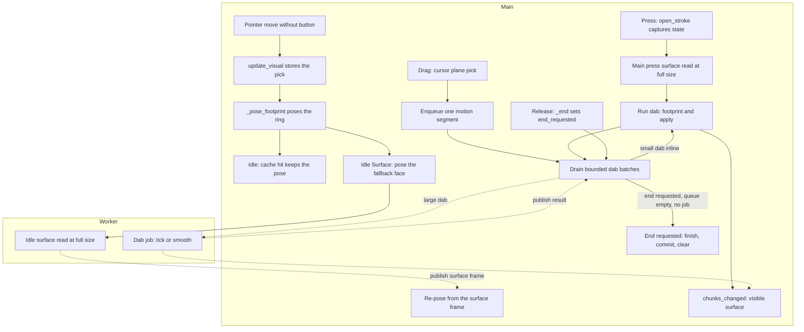
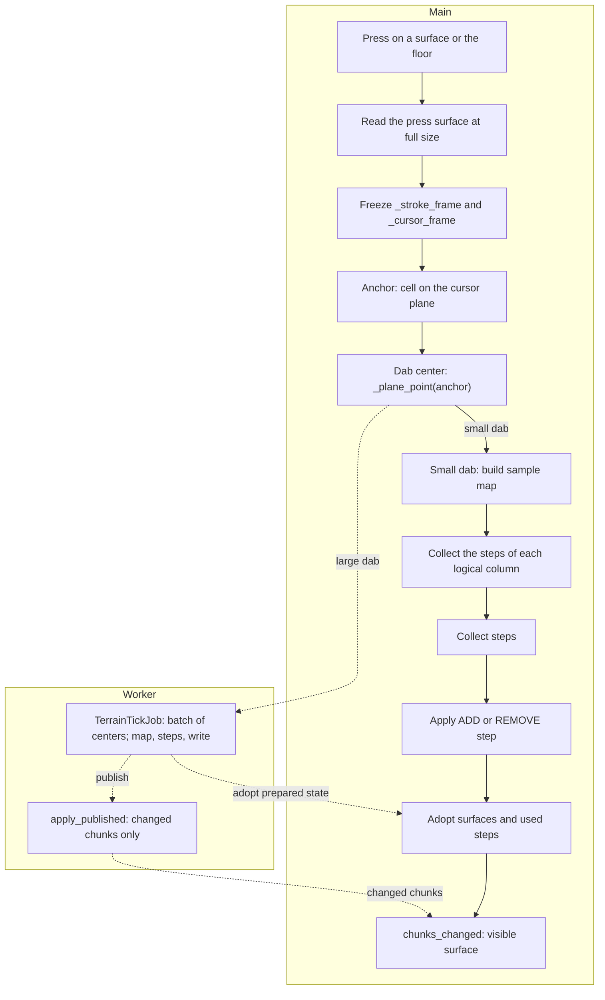
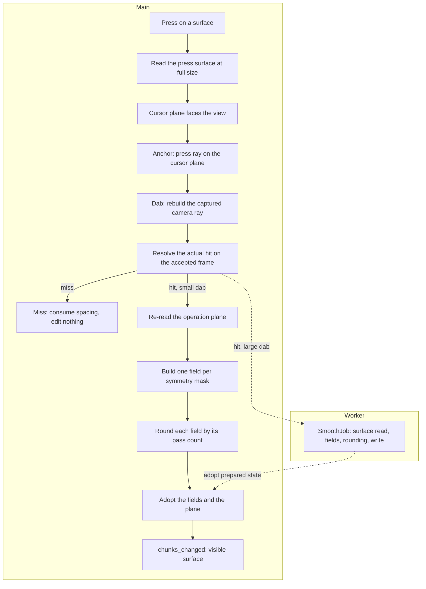
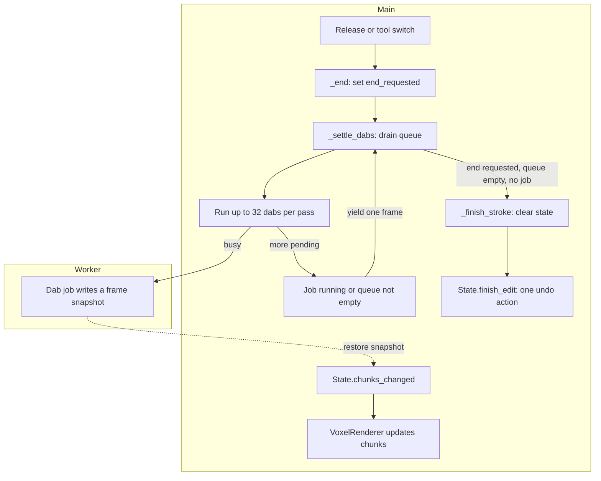
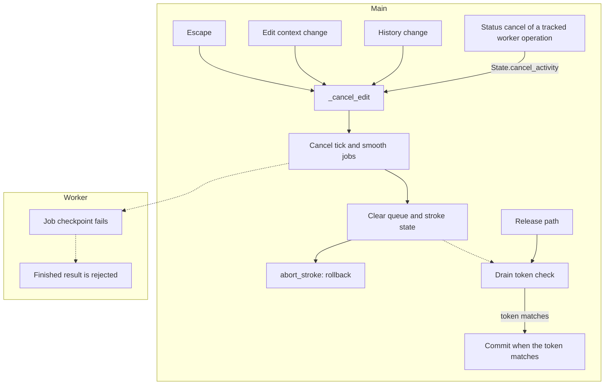

# Terrain tool flows

This page shows the current high-level flows of Terrain Build, Flatten, and Smooth.
Grab and Pose are deform tools. See [deform.md](deform.md).
It covers the cursor ring, press, stroke queue, visible surface updates, commit, and cancel.
It cites the current source only.
It does not describe a target design.

Read each graph from top to bottom.
`Main` means the main thread.
`Worker` means the worker pool.

## Terms

- **Footprint ring**: the one white leaf ring named `Footprint`. All three tools pose it. It does not predict the next voxels.
- **Idle pose**: the ring pose while no stroke is open. It uses live inputs.
- **Idle surface read**: the surface read of a hover on a model. It runs on the worker pool at the full size.
- **Stroke pose**: the ring pose of an open stroke. It uses the captured frame, size, and context.
- **Accepted input**: a press or motion cell that enters the stroke queue.
- **Press surface read**: the frame read at the press on the main thread.
- **Operation plane**: `_stroke_frame`. Build keeps its normal and moves its origin. Flatten keeps it. Smooth re-reads it.
- **Cursor plane**: `_cursor_frame`. It places anchors and dab centers.
- **Visible surface**: the mesh that the viewport shows after a chunk update.
- **Size**: the brush diameter in cells. Size 1 is one voxel and size 3 is a 3x3 block.
- **Falloff weight**: the influence of one footprint cell. The nearest cell of every size weighs one.
- **Strength**: the whole layer count of one dab at full weight. The falloff scales it per voxel.

## Shared Resource and captured operation state

`TerrainToolSettings` is one shared `Resource`.
The terrain tool, the option bar, and the toolbar preload it.
The option bar and the toolbar change it.
The tool reads it for the idle ring and the press.

`TerrainTool.open_stroke` copies the stroke inputs into `TerrainTool.StrokeInputs`.
The record holds the tool, grow mode, size, strength, falloff, and a duplicated material.
It also holds the frozen edit context, its selection, and the frame index.
The mutable execution state stays on the tool: planes, anchors, samples, and drains.
The tool keeps the document and source frame.
A later option change cannot alter an accepted dab.

`State.begin_edit` supplies the frozen edit context.
`State.drawing_context` returns that context while an edit is open.
The context holds symmetry axes, the symmetry origin, and the selection.

The pure preparation code lives in `TerrainPrep`.
The worker jobs and the tool read the same functions.
The jobs also receive their own frame snapshots.
They read job inputs such as samples, fields, or moves.

Source:

- [`TerrainToolSettings`](../../../plugins/Terrain/TerrainToolSettings.gd#L42-L95)
- [`Toolbar._select_id`](../../../plugins/Terrain/Toolbar.gd#L25-L33)
- [`Options._sync`](../../../plugins/Terrain/Options.gd#L38-L52)
- [`TerrainTool.open_stroke`](../../../plugins/Terrain/TerrainTool.gd)
- [`TerrainTool.StrokeInputs`](../../../plugins/Terrain/TerrainTool.gd)
- [`TerrainPreview.footprint_depth`](../../../plugins/Terrain/TerrainPreview.gd)
- [`State.drawing_context`](../../../Globals/State/State.gd#L350-L355)
- [`TerrainPrep`](../../../plugins/Terrain/TerrainPrep.gd#L1-L191)

## Reused definitions

| Definition | Consumers |
| --- | --- |
| `TerrainPreview.compute_sample_map` | Build and Flatten dab |
| `TerrainPreview.compute_smooth_fields` | Smooth dab |
| `TerrainPrep.collect_steps` | Build and Flatten dab and tick job |
| `TerrainGeometry.build_layer_cells` and `flatten_action` | Dab execution |
| `TerrainFrame.reflected` | Sample map, Smooth fields, and ring mirrors |
| `TerrainPreview.masks_for` | Ring mirrors and dab preparation |
| `TerrainRing.legacy_plane_ring` | The ring mesh of every tool |

## Common cursor, press, and stroke queue

The idle ring is the only pointer visual.
It is one leaf mesh. No cell map and no preview mesh exist.
`update_visual` stores the pick and poses the ring on every pointer motion.
An idle pick keeps the frame that `TerrainPreview` publishes.
The idle read runs the local surface read at the active size, on the worker pool.
A floor miss uses the floor plane.
The idle read matches the press read, so the ring shows the orientation the stroke will apply.
The ring keeps its fallback pose while the read runs, so a move stays cheap.
The ring snaps to whole cells. A move inside one cell keeps the pose.
The ring is centered on the picked cell, half a cell out along the pose normal.
It is not offset by half a cell across the grid, so its cells cover the voxel
cells that the dab writes.
The pose does not project the cell onto the frame plane.
That plane drifts away from the terrain, as the Smooth surface plane does.
The ring would then leave the cell under the pointer.
The tool caches the idle pose by its inputs.
A repeat of one cell sets transforms only.
A cell change, a document change, an undo or redo, or a clear drops the cache.
A crossed cell re-reads the surface at the full size, on the worker pool.
The entered face is not part of the pose gate or of the surface cache key.
A ray that grazes a convex edge can report either face for the same cell, and a
re-reading on that flip rotated the ring under a still pointer.
The pose uses a published read only when it belongs to the current cell.
A slower read for an older cell can finish after the pointer moved, and it must
not rotate the ring.
Model picking still runs and can have a ray-distance cost.

A press is different.
`open_stroke` captures the stroke state and begins the edit.
`_pick_start` computes the press frame on the main thread at the full size.
`_apply_pick` starts the press dab at once.

Build, Flatten, and Smooth queue motion segments.
Each accepted motion with the left button becomes one segment.
`_enqueue_segment` stores the two endpoint cells.
`DabPath` generates the crossed cells during the drain.
A long motion therefore holds one queue entry per real motion, not one entry per crossed cell.

Source:

- [`TerrainTool.handle_input`](../../../plugins/Terrain/TerrainTool.gd)
- [`TerrainTool.update_visual`](../../../plugins/Terrain/TerrainTool.gd)
- [`TerrainTool._pose_footprint`](../../../plugins/Terrain/TerrainTool.gd)
- [`TerrainTool._footprint_frame`](../../../plugins/Terrain/TerrainTool.gd)
- [`TerrainTool._hide_footprint`](../../../plugins/Terrain/TerrainTool.gd)
- [`TerrainTool._set_preview`](../../../plugins/Terrain/TerrainTool.gd)
- [`TerrainPreview.hover_frame`](../../../plugins/Terrain/TerrainPreview.gd)
- [`TerrainPreview.HoverJob`](../../../plugins/Terrain/TerrainTool.gd)
- [`TerrainTool._invalidate_idle_pose`](../../../plugins/Terrain/TerrainTool.gd)
- [`TerrainTool.open_stroke`](../../../plugins/Terrain/TerrainTool.gd)
- [`TerrainTool._pick_start`](../../../plugins/Terrain/TerrainTool.gd)
- [`TerrainTool._frame_for_pick`](../../../plugins/Terrain/TerrainTool.gd)
- [`TerrainTool._apply_pick`](../../../plugins/Terrain/TerrainTool.gd)
- [`TerrainTool._enqueue_segment`](../../../plugins/Terrain/TerrainTool.gd)
- [`TerrainTool.DabPath`](../../../plugins/Terrain/TerrainTool.gd)

## Press surface placement

`_frame_for_pick` has two paths.

1. A hit. Build, Flatten, and Smooth run `TerrainFrame.from_surface` on the main thread at the active size. The read falls back to the clicked face when the samples are sparse or degenerate.
2. A floor miss. It uses the floor frame.

A floor miss is special.
The floor frame plane is the outer face of the first buildable layer, one cell
above the grid that the user sees.
An angled ray meets that higher plane one cell toward the camera.
The cursor plane therefore moves down to the floor grid for the whole stroke.
`TerrainTool._floor_grid_frame` makes that plane.
The press and every later motion then name the same floor cell.
The ring stays on that grid plane when the stroke opens, so the press does not
lift it one cell.
The Build ground may move the operation plane.
`TerrainTool._stroke_cursor_frame` keeps the cursor plane on the grid when it does.
Without that rule the seed lands in front of the clicked cell, and a one-pixel
move adds cells that the user did not ask for.

The press read always runs on the main thread at the full size.
The idle read uses the same size, so the ring shows the orientation the press will use.
The idle read runs on the worker pool, so a full-size hover keeps the main thread free.
The request snapshot holds only the chunks in the read box.
`watch_chunks` builds the box and `copy_chunks` freezes it.
The box reaches `watch_half(radius) + radius + 1` cells around the picked cell.
A hover then costs the read box, not the whole frame.
The press read still costs about 55 milliseconds at size 32.
That press read cost is an open task in `../../../TASKS.md`.

Source:

- [`TerrainTool._frame_for_pick`](../../../plugins/Terrain/TerrainTool.gd)
- [`TerrainTool._pick_start`](../../../plugins/Terrain/TerrainTool.gd)
- [`TerrainFrame.from_surface`](../../../plugins/Terrain/TerrainFrame.gd#L67-L84)
- [`TerrainFrame.from_face`](../../../plugins/Terrain/TerrainFrame.gd#L33-L44)
- [`TerrainFrame.from_floor`](../../../plugins/Terrain/TerrainFrame.gd#L50-L58)
- [`TerrainPreview.watch_chunks`](../../../plugins/Terrain/TerrainPreview.gd)
- [`VoxelFrame.copy_chunks`](../../../Globals/State/Document/VoxelFrame.gd)

## Build

Build uses a cylinder brush.
The size is the brush diameter.
The height is `max(1, ceil(size * 0.25))`: half above and half below the plane.
The operation plane and the cursor plane are one frame.
`_plane_point` projects each anchor cell onto that plane.
The plane keeps the press normal for the whole stroke.
The origin moves along the normal to the base surface under the cursor.
The base is the surface that the column had before this stroke first sampled it.
The ground never follows the average of the footprint, so the brush never lifts
itself on a flat floor.
A later stroke starts from the grown surface, so repeated strokes build up.
The ground ray under the cursor also moves the plane, so a drop or a rise of the
surface under the pointer moves the layer with it.

`TerrainGeometry.dominant_step` returns the neighbor one cell along the dominant
axis of the normal.
`TerrainGeometry.build_layer_cells` adds that cell for Add.
Dig clears the surface and continues inward while the next cell is occupied.
A gentle plane grows upward. A steep plane grows sideways.
Both use the dominant axis, so they feel the same.

All three terrain tools share the one footprint ring.
The ring is one separate white leaf mesh named `Footprint`.
The color is set once on the cloned material. Paint color and stroke material never tint it.
The ring is identical in idle, press, pending job, held, drain, and release.
The mesh is cached per size from 1 through 32.
The ring spans the size, so size 32 gives a ring 32 cells wide.
The ring shows its perimeter only. It has no fill and no `VoxelEdges`.
The ring skips the depth test, so it stays readable inside geometry.
It then draws through a hill in front of it. A depth-tested ring hides in the
voxels around the cursor, which is worse.
An idle Build pick reads the local surface at the active size, on the worker pool.
An idle floor miss puts the ring on the floor grid plane.
The floor frame plane is the outer face of the first buildable layer, one cell
above that grid, so the ring would float without that rule.
An open stroke keeps its captured frame, so a Smooth ring still shows the re-read
plane when the pointer leaves the model for a moment.
Idle Build runs no map, snapshot, or job.
Model picking still runs and can have a ray-distance cost.
A press still runs the actual surface read, operation plane, kernels, and undo.
Accepted edits are unchanged.
A visual sub-voxel move changes no accepted dab. The `_press_*` state and accepted anchors are separate.
A stroke pose uses the captured frame, size, and context. The idle pose uses live inputs.
The pose resets on a document change, a finish, a cancel, a switch, or an exit.
A normal release keeps a fresh pointer position.
There is no new framework.

The per-column support lookup uses `TerrainPreview.footprint_depth`.
The Build sample map reads within the cylinder half-height, `max(1, ceil(size * 0.25))`.
Flatten keeps the 64-cell support bound.
Smooth returns `depth_for(radius)`.
The lookup is bounded, not unbounded.

The falloff weight comes from `TerrainGeometry.weight_at`.
The falloff starts at the nearest cell of the footprint and ends at the rim.
`TerrainGeometry.disk_inner` gives that nearest distance.
An odd size centers on one cell, so its nearest distance is zero.
An even size centers between four cells, so its nearest distance is the half-cell
diagonal.
The nearest cell of every size therefore weighs exactly one.

The strength is a whole layer count.
One dab adds `round(strength * weight)` layers to each column, where `weight` is
the falloff weight of that column.
A weight below one half adds nothing.
The count is per dab, so no fraction carries into the next dab.
At strength one every column whose weight reaches one half gains one layer.
A higher strength tapers the layer count toward the rim.

The sample map reads the local surface along the surface normal.
`TerrainPreview.compute_sample_map` builds the samples.
The first sample of a column records `base_surface` before the stroke writes it.
`TerrainPreview.center_surface` returns the base of the sample nearest the dab center.
`TerrainFrame.recenter_to` moves the plane origin to that base, clamped to half the cylinder height.
Build collects one step list per stable logical column, not per moving 3D anchor.
`TerrainPrep.collect_steps` produces the steps that the tick applies.
The small path builds the map, collects the steps, then applies the tick.

The surface read of a column starts at the operation plane.
A grown column can sit many layers above that plane.
`TerrainTool._stroke_columns` keeps the tracked top of every logical column for
the whole stroke.
The read uses that top before it scans the frame.
Without the cache a revisit reads from the old plane, and a column taller than
the read bound returns `NONE`.
The Build read bound is `min(64, max(8, size * 2))`, so a first read still
reaches a tall column.
A `NONE` surface in Add seeds the captured floor cell, so a failed read would
write a lone floor voxel.

Build Add writes the block cells above the tracked surface.
Dig clears the block cells from the surface inward.
Both use the same target and block, so they match.
The Add material is the captured stroke material.
The Remove material is transparent.
An empty surface seeds one cell on the captured floor.
Only a truly empty column reaches the seed, because a tracked column keeps its
top.
The seed cell is the first buildable cell on the side of the floor plane that
the pointer is on, so a stroke from below seeds below the plane.
The seed ignores where the stroke started, so a stroke that began on a voxel
still lays cells on the floor when the pointer reaches it.
The seed uses the captured floor plane, not the moving operation plane.

Both dab paths share one tick job.
A small dab runs `TerrainTickJob.run` inline when the work is at most 4096.
A large dab runs the job on the worker pool.
A large drag batches up to `_prep_batch` crossed centers in one job.
Each center reads the frame and the surface that the previous center left.
The batch size follows the worker time of the last job and targets `PREP_BATCH_TARGET_US`.
The job takes a shared `job_frame`, so it copies no chunk until it writes one.
The result publishes only `job.changed_chunks` with `VoxelFrame.apply_published`.
The tick owns the Build step rules.
Add and Dig call `TerrainGeometry.build_layer_cells` for the layer cells.
No preview calls these rules.

Source:

- [`TerrainTool._run_dab`](../../../plugins/Terrain/TerrainTool.gd)
- [`TerrainTool._plane_point`](../../../plugins/Terrain/TerrainTool.gd)
- [`TerrainTool._apply_dab_at`](../../../plugins/Terrain/TerrainTool.gd)
- [`TerrainTool._start_prep_batch`](../../../plugins/Terrain/TerrainTool.gd)
- [`VoxelFrame.apply_published`](../../../Globals/State/Document/VoxelFrame.gd)
- [`VoxelFrame.job_frame`](../../../Globals/State/Document/VoxelFrame.gd)
- [`TerrainTool._run_tick`](../../../plugins/Terrain/TerrainTool.gd)
- [`TerrainPreview.footprint_depth`](../../../plugins/Terrain/TerrainPreview.gd)
- [`TerrainTool._sample_map`](../../../plugins/Terrain/TerrainTool.gd)
- [`TerrainTool.TerrainTickJob._build_step`](../../../plugins/Terrain/TerrainTool.gd)
- [`TerrainGeometry.dominant_step`](../../../plugins/Terrain/TerrainGeometry.gd)
- [`TerrainGeometry.build_layer_cells`](../../../plugins/Terrain/TerrainGeometry.gd)
- [`TerrainPreview.center_surface`](../../../plugins/Terrain/TerrainPreview.gd)
- [`TerrainFrame.recenter_to`](../../../plugins/Terrain/TerrainFrame.gd)
- [`TerrainPrep.progress_key`](../../../plugins/Terrain/TerrainPrep.gd#L52-L55)
- [`TerrainPrep.collect_steps`](../../../plugins/Terrain/TerrainPrep.gd#L91-L112)
- [`TerrainTool._setup_footprint`](../../../plugins/Terrain/TerrainTool.gd)
- [`TerrainTool._pose_footprint`](../../../plugins/Terrain/TerrainTool.gd)
- [`TerrainRing.legacy_plane_ring`](../../../plugins/Terrain/TerrainRing.gd)

## Flatten

Flatten keeps a fixed operation plane and cursor plane.
The footprint center is the anchor projected onto that plane.
Flatten keeps the 64-cell support bound. Build reads within its cylinder.

Flatten collects one step list per sample anchor.
The anchor is already stable on the fixed plane.
`TerrainPrep.collect_steps` reads that key.
The small path builds the map, collects the steps, then applies the flatten action.

`TerrainGeometry.flatten_action` compares the tracked surface to the operation plane.
A surface whose outer face is within `FLATTEN_THRESHOLD` of the plane settles.
A surface above the plane is cut.
A surface below the plane fills one layer outward.
A settled sample reports no cell.
The fill copies the full material of the local original support.
The cut writes a transparent material.
An empty surface fills the cell just inside the operation plane.
The plane comes from the stroke, not from the floor, so a stroke that started on
a surface fills at that surface when it leaves the model.
It never drops a layer at another depth.
No preview calls this action rule.

Source:

- [`TerrainTool.FLATTEN_THRESHOLD`](../../../plugins/Terrain/TerrainTool.gd)
- [`TerrainTool.TerrainTickJob._flatten_step`](../../../plugins/Terrain/TerrainTool.gd)
- [`TerrainTool.TerrainTickJob._fill_material`](../../../plugins/Terrain/TerrainTool.gd)
- [`TerrainPrep.progress_key`](../../../plugins/Terrain/TerrainPrep.gd#L52-L55)
- [`TerrainGeometry.flatten_action`](../../../plugins/Terrain/TerrainGeometry.gd#L411-L435)

## Smooth

Smooth does not use the surface plane to place the whole stroke.
The cursor plane faces the view.
It keeps the surface origin.
The press anchor is the press ray intersection with that cursor plane.
The anchor and dab center stay near the surface on a slope.

The accepted input stores the camera family and the crossed anchor cells.
Each dab reconstructs its own ray from that family.
A perspective camera uses the captured focus.
An orthographic camera keeps the captured direction and press offset.
`VoxelPicking.start_pick` resolves the real hit and entry on the accepted frame at dab time.
A miss consumes the spacing and applies no Smooth edit.

The operation plane is separate from the cursor plane.
`Prep.smooth_surface_frame` re-reads it from the current surface.
The previous frame is the fallback and the seed.
The entered face of the actual hit wins when it is nearly perpendicular to the
stroke normal, so a vertical side follows its own axis.
Every other case reads the local surface.

`TerrainPreview.compute_smooth_fields` builds one field per active symmetry mask.
The field fills a sphere of the brush size around the dab point.
`TerrainGeometry.sphere_offsets` gives the cells within `size * 0.5`.
The field holds the writable cells and the falloff weight of each cell.
`SmoothOperation.advance` rounds the field on a frozen occupancy set.
Each dab rebuilds the field from the current surface.
A tall step at the brush rim is outside the sphere, so Smooth no longer reaches
it.
A camera change during the stroke ends the gesture.

Source:

- [`TerrainTool._apply_pick`](../../../plugins/Terrain/TerrainTool.gd)
- [`TerrainTool._run_smooth_dab`](../../../plugins/Terrain/TerrainTool.gd)
- [`TerrainTool._next_dab_cell`](../../../plugins/Terrain/TerrainTool.gd)
- [`TerrainTool._smooth_surface_frame`](../../../plugins/Terrain/TerrainTool.gd)
- [`TerrainTool._build_smooth_fields`](../../../plugins/Terrain/TerrainTool.gd)
- [`TerrainTool.SmoothJob._prepare`](../../../plugins/Terrain/TerrainTool.gd)
- [`TerrainPrep.smooth_surface_frame`](../../../plugins/Terrain/TerrainPrep.gd#L134-L150)
- [`TerrainPreview.compute_smooth_fields`](../../../plugins/Terrain/TerrainPreview.gd)
- [`TerrainGeometry.sphere_offsets`](../../../plugins/Terrain/TerrainGeometry.gd)
- [`TerrainTool._frame_drag`](../../../plugins/Terrain/TerrainTool.gd)

## Release, drain, commit, and visible surfaces

Release does not always commit at once.
`_end` sets `_end_requested` and starts the drain.
A motion with no left button also ends a stroke whose release was lost.
A plugin switch and a tool, mode, or source change also end the stroke like a release.
`_settle_dabs` runs small dabs inline and waits for worker jobs.
It applies at most `DABS_PER_DRAIN` dabs in one pass.
A longer accepted path yields one frame and continues.
The stroke finishes only when the queue is empty and no job runs.
`_finish_stroke` then clears the stroke state and calls the base close.
`State.finish_edit` records one undo action for the whole stroke.

The visible model surface changes earlier.
Each tick or Smooth job restores its edited snapshot into the source frame.
The tool marks the document bounds dirty.
It emits `chunks_changed`.
`VoxelRenderer` updates the affected chunks.
The viewport can therefore show intermediate surfaces before the undo action exists.
The undo action still covers the whole stroke.

Source:

- [`TerrainTool._end`](../../../plugins/Terrain/TerrainTool.gd)
- [`TerrainTool._settle_dabs`](../../../plugins/Terrain/TerrainTool.gd)
- [`TerrainTool._finish_stroke`](../../../plugins/Terrain/TerrainTool.gd)
- [`TerrainTool._finish_tick`](../../../plugins/Terrain/TerrainTool.gd)
- [`TerrainTool._finish_smooth`](../../../plugins/Terrain/TerrainTool.gd)
- [`State.finish_edit`](../../../Globals/State/State.gd#L563-L575)
- [`VoxelRenderer`](../../../ui/Viewport/VoxelRenderer.gd#L93-L102)

## Cancel ownership

The terrain tool owns cancel for its open stroke.
Escape calls `_cancel_edit`.
A context change calls `_cancel_edit` through `State.edit_context_changing`.
A history change calls `_cancel_edit` through `State.history_changed`.
The status bar can cancel a tracked worker operation.
Only a large dab or drag starts one.
A small inline stroke has no operation id.
The callback is the `_cancel_edit` that `State.begin_operation` stored.

`_cancel_edit` cancels every running dab job.
It clears the accepted path and stroke state.
It calls `abort_stroke`.
`State.cancel_edit` restores the start snapshots.
A cancelled worker result fails its checkpoint and cannot publish.

The drain has its own token: the stroke id and the transaction.
A cancelled or replaced stroke cannot retire a newer drain.
A zombie drain reads the token before it touches the path or the finish.
The release path commits only when the same token still owns the stroke.

Source:

- [`TerrainTool._cancel_edit`](../../../plugins/Terrain/TerrainTool.gd)
- [`TerrainTool._job_is_current`](../../../plugins/Terrain/TerrainTool.gd)
- [`TerrainTool._settle_dabs`](../../../plugins/Terrain/TerrainTool.gd)
- [`State.begin_operation`](../../../Globals/State/State.gd#L397-L412)
- [`State.cancel_activity`](../../../Globals/State/State.gd#L436-L448)
- [`State.cancel_operation`](../../../Globals/State/State.gd#L419-L433)
- [`TerrainTool._run_tick`](../../../plugins/Terrain/TerrainTool.gd)
- [`TerrainTool._start_prep_dab`](../../../plugins/Terrain/TerrainTool.gd)
- [`TerrainTool._run_smooth`](../../../plugins/Terrain/TerrainTool.gd)
- [`State.cancel_edit`](../../../Globals/State/State.gd#L581-L590)
- [`VoxelTool.abort_stroke`](../../../Globals/State/Tools/VoxelTool.gd)

## Mode matrix

| Mode | Placement | Preparation | Material | Selection | Symmetry | Undo | Cancel |
| --- | --- | --- | --- | --- | --- | --- | --- |
| Build | Cylinder brush. The plane keeps the press normal and moves its origin to the center base. Anchor projects to the plane. | Sample map inside the cylinder half-height. The first sample of a column records the base. One step list per logical column. | Add writes one dominant-axis cell. Dig clears the surface and continues inward. | The cell must be empty or occupied and allowed. | Sample map mirrors every active mask. | One action at stroke close, if cells changed. | Escape, context, or history cancel rolls back. Status cancel applies to a tracked worker operation. |
| Flatten | Fixed operation and cursor plane. Anchor projects to the plane. | Sample map with `footprint_depth` 64. One step list per anchor. | Fill copies local support. Cut writes transparent. | Cut surface and fill destination must pass. | Sample map mirrors every active mask. | One action at stroke close, if cells changed. | Same as Build. |
| Smooth | Cursor plane faces the view. Operation plane re-reads. | Each dab resolves its own captured ray. Fields follow the surface. Footprint depth uses `depth_for(radius)`. | Fill copies the nearest local support. Remove writes transparent. | Field cells are filtered at build time. | One field per mask, with its own falloff weights. | One action at stroke close, if cells changed. | Same as Build. A camera change ends the gesture. |

All three modes pose the shared footprint ring.
The ring shows the footprint, not the edit.

## Current limits and non-claims

- The size setting clamps to 1 through 32. Every sculpt tool shares this bound.
- Build and Flatten use `TerrainPreview.footprint_depth` 64. Smooth uses `depth_for(radius)`.
- The stroke drain applies at most 32 dabs in one pass. A longer path yields one frame and continues.
- A small inline stroke has no tracked operation id. A large worker dab or drag starts one.
- All three tools pose the shared footprint ring. It is built from `TerrainRing.legacy_plane_ring`.
- The idle ring reads the local surface at the active size, on the worker pool. A floor miss uses the floor plane.
- The ring keeps its fallback pose while an idle read runs, so a full-size hover keeps the main thread free.
- The ring is the whole cursor. It has no idle map and no terrain prediction.
- All press reads run on the main thread at the full size.
- The press read costs about 55 milliseconds at size 32. That press read cost is an open task in `../../../TASKS.md`.
- The `TerrainPreview` helpers accept a `TerrainQueryContext`. The tool never constructs one.
- The column walk at maximum size on sparse models remains a pending measurement.
- This page does not assert a shared 1 through 64 size range.
- This page describes the local Smooth rounding fields only.
- There is no new `CursorJob` or controller hierarchy.

Source:

- [`TerrainToolSettings.radius`](../../../plugins/Terrain/TerrainToolSettings.gd#L51-L58)
- [`TerrainTool.DABS_PER_DRAIN`](../../../plugins/Terrain/TerrainTool.gd)
- [`TerrainQueryContext`](../../../plugins/Terrain/TerrainQueryContext.gd)

## Implemented mechanisms

These mechanisms are in current code.
The verification history is in the composition guide.

### Captured stroke inputs

`TerrainTool.StrokeInputs` holds the tool, grow mode, size, strength, falloff, and a duplicated material.
It also holds the frozen edit context, its selection, and the frame index.
It is a Terrain-family record. A new tool must copy the capture pattern, not reuse this type or its fields.
The mutable execution state stays on the tool.
A later settings or selection change cannot alter an accepted dab.

### Shared footprint ring

All three tools pose one white leaf ring named `Footprint`. See [Build](#grow).
It uses `TerrainRing.legacy_plane_ring`. It does not predict the next voxels.
The mesh is cached per size. The mirrors are symmetry copies.
A pose sets transforms only, so a pointer move stays bounded by the mask count.
The pose origin is the picked cell center, half a cell out along the pose normal.
The ring cells then cover the voxel cells of the footprint.

### Idle pose cache

The tool caches the last idle pose by its inputs. See [Common cursor, press, and stroke queue](#common-cursor-press-and-stroke-queue).
A repeat of one cell sets transforms only. It costs about 10 microseconds.
A crossed cell re-reads the surface at the full size, on the worker pool.
A cell change, a document change, an undo or redo, or a clear drops the cache.
A frame cells change signal invalidates the pose of the current frame.
An undo or redo signal drops the cache while the tool is idle and re-poses from the last pick.
There is no new `CursorJob` or controller hierarchy.

### Footprint depth

`TerrainPreview.footprint_depth(tool, radius)` returns 64 for Build and Flatten.
It returns `depth_for(radius)` for Smooth.
`TerrainTool._footprint_depth(radius)` reads the active tool.

### Shared job wiring

`TerrainTool._make_tick_job` fills the common Build and Flatten inputs.
`TerrainTool._make_smooth_job` fills the common Smooth inputs.
The callers add samples, preparation inputs, fields, or the application count.

### Frozen benchmark depth

`TerrainTool._depth(radius)` remains only as the frozen benchmark reference.
The active path uses `_footprint_depth`.
Do not change the frozen benchmark algorithm.

## Consolidation and simplification candidates

These are the remaining candidates.
They are not current behavior.
Each candidate states facts and a hypothesis.

### 1. Use one job runner for inline and worker paths

- **Existing mechanism**: repeated `work <= INLINE_EDIT_LIMIT` branches in `_run_tick` and `_run_smooth`.
- **Consumers**: Build, Flatten, and Smooth.
- **Contract**: a small press dab must finish in its input event. A large job must use the worker pool.
- **Tradeoff**: a helper can hide the synchronous inline order that the press needs.
- **Facts**: the three paths repeat the same operation setup and finish sequence. `_make_tick_job` and `_make_smooth_job` now share the job wiring, but the inline and worker branches remain.
- **Hypothesis**: one runner can reduce drift in operation ids and cancel handling.

### 2. Share the local support search where policy allows

- **Existing mechanism**: `TerrainTickJob._fill_material` and `SmoothJob._source_material`.
- **Consumers**: Flatten fill and Smooth fill.
- **Contract**: Flatten fill reads pending changes first. Smooth fill reads the frozen snapshot and never uses the active paint.
- **Tradeoff**: sharing the policy can change material results. Sharing only the offset order is safer.
- **Facts**: both search local neighbors for a support material. Their source rules differ.
- **Hypothesis**: a shared offset ordering helper can remove duplicate loops without changing the fill policy.
