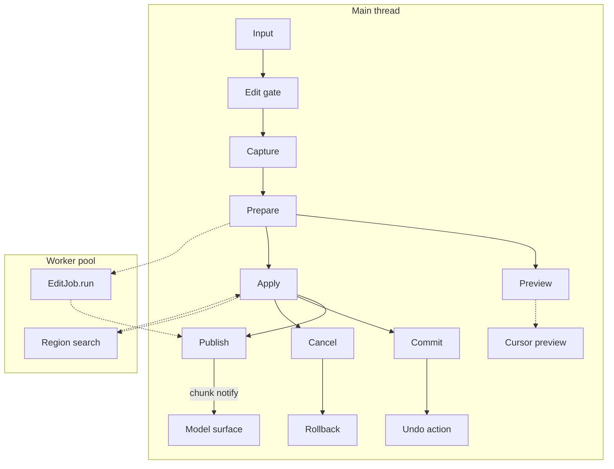
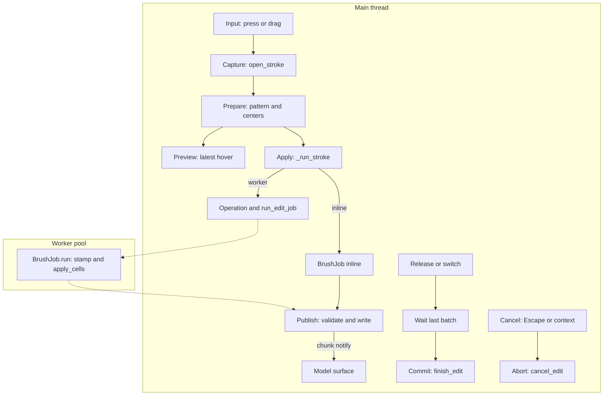
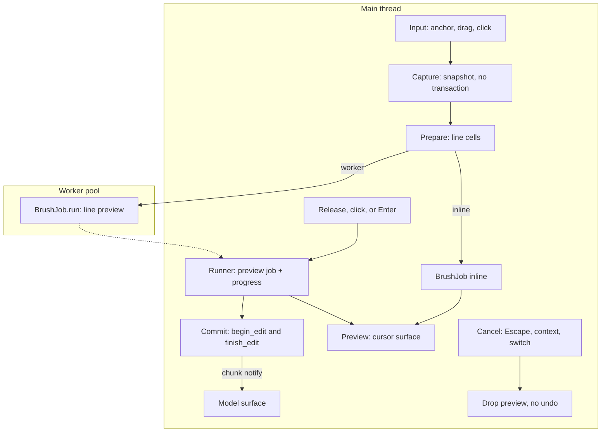
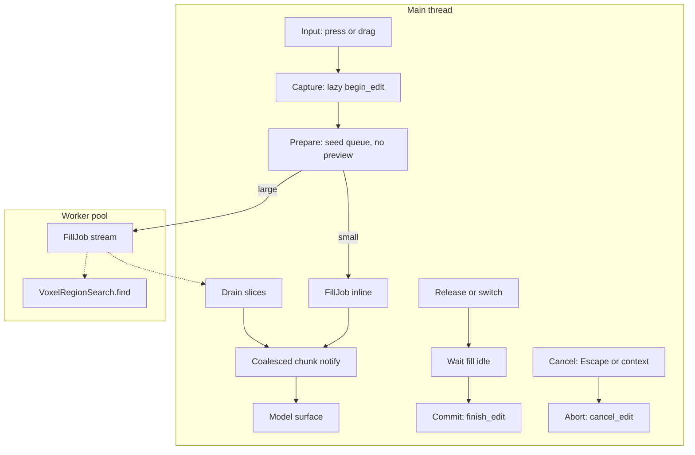
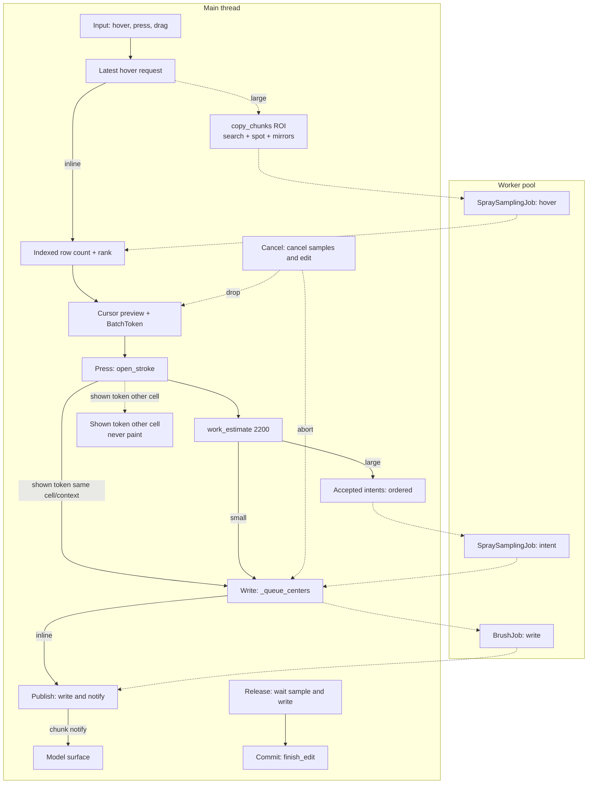
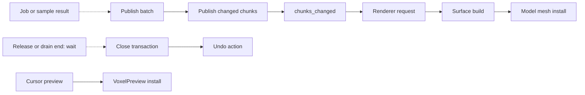

# Drawing tool flows

This map covers the shipped drawing tools in LVE.
The tools are Brush, Line, Paint Brush, Fill, and Spray.
The map shows control flow, not class structure.
The source links point to the current code.
See [Shared paths and utilities](shared-and-utilities.md) for the input spine, worker helpers, and preview mesh details.

Every graph uses this shared vocabulary.
A tool can combine stages or omit a stage that it does not have.
A missing stage is named in the graph or in the notes.

1. **Input** receives the pointer or key event.
2. **Capture** records the inputs that the accepted work uses.
3. **Prepare** builds the cells or the search request.
4. **Preview** shows replaceable work on the cursor.
5. **Apply** runs accepted work on the main thread or the worker pool.
6. **Commit** closes the edit transaction and records one undo action.
7. **Cancel** drops or rolls back pending work and records no undo action.

Read `Main` as the main thread.
Read `Worker` as the worker pool.
A solid edge is a direct call.
A dashed edge is asynchronous work, a replaceable request, or a wait relation.

## Family overview

Two engines serve the five tools.

| Engine | Tools | Core symbols |
| --- | --- | --- |
| Stamp engine | Brush, Line, Paint Brush, Spray | `StrokeTool`, `BrushJob`, `StampPatternJob` |
| Fill engine | Fill | `FillTool`, `FillJob`, `VoxelRegionSearch` |

The brush tools and the paint tools use separate settings resources.
A brush size change does not alter a paint size.
Brush and Paint Brush share one engine and one graph.
Their policy table shows the differences.
Line extends `BrushTool` but does not use the stroke transaction.
Spray extends `StrokeTool` and adds an accepted sample queue.
Fill extends `VoxelTool` directly.

## Brush and Paint Brush

Brush and Paint Brush use the same graph.
A valid press opens one edit transaction.
A drag queues stamp centers.
A large stamp runs on the worker pool.
Release and a tool switch commit the stroke.
Escape and a context change roll the stroke back.

- `HOV` is replaceable. A settings, color, or view-axis change replaces it. A large pattern builds in `StampPatternJob` on the worker.
- `RUN` owns the accepted centers. A center that arrives during a worker batch joins the next batch. No center is dropped.
- `WAIT` is the release. `COM` runs only after the last batch publishes. Release is not job completion.
- `MESH` is the model surface. Its request follows `PUB`, not `COM`.
- `ABT` restores the start snapshot. It records no undo action.

### Brush and Paint Brush policy

| Policy | Brush | Paint Brush |
| --- | --- | --- |
| Picked cell | Add target for add, hit for erase | Picked hit cell |
| Requires a hit | No | Yes |
| Writes | Adds or removes the footprint | Recolors existing cells |
| Existing-cell filter | Eraser only | Always |
| Cursor | Pattern and symmetry mirrors | Pattern and symmetry mirrors |
| Undo name | `Stroke` or `Erase` | `Stroke` |
| Tool switch | Commits | Commits |

Brush modes are `PENCIL`, `LINE`, and `ERASER`.
The shipped Brush plugin selects the separate Line tool when the mode is `LINE`.
An Eraser stroke writes only cells that the frame already holds.
A Pencil stroke uses the add target in front of the clicked face.

### Brush and Paint Brush source edges

- Input gate: [`VoxelTool._unhandled_input`](../../Globals/State/Tools/VoxelTool.gd) calls `handle_input` after `State.edit_busy`.
- Capture: [`StrokeTool.open_stroke`](../../plugins/brush/StrokeTool.gd) calls `State.begin_edit` and reads `tx.edit_context`.
- Prepare: [`StrokeTool._apply_pick`](../../plugins/brush/StrokeTool.gd) calls `_settings.pattern`, `PixelPerfectStroke.feed`, or `StrokeLine.cells`.
- Apply: [`StrokeTool._run_stroke`](../../plugins/brush/StrokeTool.gd) builds `BrushJob` and uses `State.run_edit_job` above `INLINE_EDIT_LIMIT`.
- Worker body: [`BrushJob.run`](../../plugins/brush/StrokeTool.gd) calls `apply_cells`, `EditContext.expand`, and `VoxelFrame.set_cells`.
- Publish: [`StrokeTool._finish_edit`](../../plugins/brush/StrokeTool.gd) calls `VoxelFrame.apply_published` and `State.chunks_changed.emit`.
- Commit: [`StrokeTool.close_stroke`](../../plugins/brush/StrokeTool.gd) calls `State.finish_edit` with `Stroke` or `Erase`.
- Cancel: [`StrokeTool._cancel_edit`](../../plugins/brush/StrokeTool.gd) calls `abort_stroke`, which calls `State.cancel_edit`.
- Preview: [`StrokeTool._show_brush_shape`](../../plugins/brush/StrokeTool.gd) calls `VoxelPreview.show_voxels`.
- Selection pattern: [`Options._on_selection_pressed`](../../plugins/brush/Options.gd) builds `StampCopyJob` and calls `use_selection`.
- Switch: [`BrushPlugin.deactivate_tool`](../../plugins/brush/BrushPlugin.gd) calls `finish_on_switch`.
- Paint policy: [`PaintBrushTool`](../../plugins/paint/PaintBrushTool.gd) returns false from `_pick_adds` and true from `_paints_existing`.

## Line

Line previews the whole path before it changes the document.
The first press sets the anchor.
A drag or a second click sets the endpoint.
A drag release, a second click, or Enter commits one line.
Escape discards it. A selection, floor, cell, or context change also discards it.

- `CAP` copies `_line_snapshot`. It does not call `State.begin_edit`. The preview does not change the document and adds no undo action.
- `PREP` uses `StrokeLine.cells(anchor, endpoint)`. A new endpoint bumps `_revision` and cancels the old preview. The latest endpoint wins.
- `RUN` owns the preview worker through `State.run_edit_job`. The runner pumps progress and joins exactly once. `LineTool._process` updates idle hover only. `_service_preview` starts the newest request after the runner returns. The Line runner is in the verified modular selection.
- `COM` runs only after the preview job completes. It opens a fresh transaction and publishes `job.changed_chunks` with `VoxelFrame.apply_published`.
- `DROP` cancels the preview. A tool switch also drops the preview. This differs from Brush and Paint Brush.
- The mesh request follows `COM`. The preview surface is separate.

### Line source edges

- Input: [`LineTool.handle_input`](../../plugins/brush/LineTool.gd) handles the anchor, endpoint, commit, and Escape.
- Capture: [`LineTool._begin_line`](../../plugins/brush/LineTool.gd) copies `_line_snapshot` and captures `State.drawing_context`.
- Prepare: [`LineTool._start_preview`](../../plugins/brush/LineTool.gd) builds `BrushJob` with `_preview_centers`.
- Preview: [`LineTool._finish_preview`](../../plugins/brush/LineTool.gd) checks `job.revision` and calls `$Cursor.show_voxels`.
- Runner: [`LineTool._start_preview`](../../plugins/brush/LineTool.gd) awaits `State.run_edit_job` with `_cancel_preview_if_stale`. The Line `_process` override calls `_update_hover` only when no anchor is open. The base `_process` is unconditional.
- Operation: [`LineTool._begin_preview_operation`](../../plugins/brush/LineTool.gd) and [`LineTool._finish_preview_operation`](../../plugins/brush/LineTool.gd) report the preview progress. Paste overrides them to share its placement operation. They are a narrow status seam, not a general hook framework.
- Commit: [`LineTool._commit_line`](../../plugins/brush/LineTool.gd) calls `State.begin_edit`, `frame.apply_published`, and `State.finish_edit`.
- Cancel: [`LineTool._cancel_edit`](../../plugins/brush/LineTool.gd) cancels `_job` and clears the preview state.
- Switch: [`LineTool.finish_on_switch`](../../plugins/brush/LineTool.gd) calls `_cancel_edit`.

## Fill

Fill replaces a connected or a matching region.
A press queues one seed.
A drag queues one seed per visited cell.
A small fill runs inline.
A large fill streams found cells from a worker and applies them in bounded slices.

- `CAP` is lazy. The first valid seed calls `open_stroke`. It freezes the source frame, material, and connected option. It does not freeze the search selection. A repeated seed is dropped.
- `PREP` queues one seed per visited cell. `_process_seeds` starts one foreground operation. Every seed of one frame shares one time budget. The search reads `State.selection.capture` when it processes each seed. The expansion uses the frozen transaction context.
- `STR` runs `VoxelRegionSearch.find` on a frame copy. `FillJob._stream_batch` pushes to a bounded `BatchQueue`. The worker waits when the queue is full.
- `DRAIN` calls `BatchCursor.apply_slice`. The callback receives `(keys, start, end)` and returns `bool`. The cursor advances only on `true`. A stale context leaves the slice pending for the next attempt. A cancelled owner discards its own cursor. `_retune_slice` sizes the next call. `_source_frame.set_cells` writes the live frame under `PUBLISH_BUDGET_US`.
- `NOTE` coalesces chunk ids with `NOTIFY_MIN_FRAMES` and `NOTIFY_MIN_INTERVAL_US`. The first notification leaves at once. The end forces a flush.
- `REL` is the release. `COM` waits for `_fill_running` false. Release is not job completion.
- Fill has no region preview. Its cursor is a static outline. This is the current policy, not a TODO.
- `ABT` bumps `_fill_revision`, cancels jobs and queues, and calls `abort_stroke`. Fill uses `open_stroke` and `abort_stroke`. It does not keep a raw edit handle.

### Fill source edges

- Input: [`FillTool.handle_input`](../../plugins/paint/FillTool.gd) queues seeds and sets `_release_pending`.
- Capture: [`FillTool._queue_seed`](../../plugins/paint/FillTool.gd) calls `open_stroke` and captures `_replacement_material` and `_stroke_connected`. It does not capture the search selection.
- Prepare: [`FillTool._process_seeds`](../../plugins/paint/FillTool.gd) builds `FillJob` and chooses inline or streaming work. It sets `selection_mask` from `State.selection.capture` for each seed.
- Inline: [`FillJob.run`](../../plugins/paint/FillTool.gd) calls `VoxelRegionSearch.find`, `apply_cells`, or `set_cells`.
- Stream: [`FillJob._stream_batch`](../../plugins/paint/FillTool.gd) pushes to `VoxelRegionSearch.BatchQueue`.
- Drain: [`FillTool._drain_fill_batches`](../../plugins/paint/FillTool.gd) applies slices and calls `_flush_chunk_notifications`.
- Commit: [`FillTool._finish_fill_stroke`](../../plugins/paint/FillTool.gd) calls `_end`, which calls `close_stroke`.
- Cancel: [`FillTool._interrupt_fill`](../../plugins/paint/FillTool.gd) cancels jobs and calls `abort_stroke`.
- Switch: [`FillTool.finish_on_switch`](../../plugins/paint/FillTool.gd) sets `_release_pending` and commits after the fill is idle.

## Spray

Spray samples random spots around the brush cell.
It counts and ranks distinct occupied cells inside the search size.
It does not gather the full reach volume or build a candidate array.
Each spot paints every existing voxel inside the spot sphere.
A small batch samples inline.
The inline gate uses indexed row work at or below 2200, not the old 2048 occupied count.
A large batch samples on the worker pool from a local ROI snapshot.
A press paints the batch that the cursor shows when that surface is valid.
If no valid surface exists, the press samples its own cell.
A drag accepts one batch per brush cell.

- `HOV` is replaceable. The newest request waits behind one running hover sample. The running sample is not cancelled. The running sample can install before the newest request starts. `_hover_epoch` rejects an older install. `VoxelPreview` coalesces requests and installs completed results in request order.
- `IDX` counts and ranks occupied chunk rows. Canonical sphere spans are cached per size. Native chunk and slot order is stable.
- The lazy Fisher-Yates keeps the old cells and RNG draws. There is no candidate array and no full reach gather.
- A direct selected footprint queries only its selected rows. It does not expand the candidate set.
- `ROI` captures a local `copy_chunks` snapshot for the search and maximum spot box. It includes every symmetry reflection.
- A captured intent resolves its sizes once. The ROI does not follow a later live crop. The source frame and token keep the live identity.
- `WORK` gates at 2200 indexed row units. The old gate was 2048 occupied cells.
- The gate excludes the cold occupancy-row build. Benchmarks report `index_builds` and `index_grid_reads`. The cold cost is measured, not fixed in milliseconds.
- `PREV` shows the exact sampled cells and an opaque `BatchToken`. A large sample builds `preview_payload` on the worker. The cursor uses `submit_prepared`.
- `PRESS` calls `open_stroke`. It reads `installed_cells` and `installed_token`. `_shown_owned_by_press` requires the token center, source frame, axes, origin, and selection to match the press and its edit context.
- A lagging surface of the same cell and context is allowed. The press paints the cells that the cursor shows. A surface of another cell never paints, even when `_batch_center` already matches the press cell. `_offered_cells_valid` still checks occupancy and selection.
- If no valid surface exists, the press samples its own cell. A small sample writes directly. A large sample becomes an accepted intent.
- The selection cache uses read-only identity and a pair of equal snapshots. A mutable selection resamples conservatively.
- One cached `SelectionIndex` serves the editor snapshot. Its read-only identity clears on a document change, selection change, or exit.
- `INT` is the accepted queue. `_pending_intents` keeps captured settings and order. A repeat of the last sample is compacted. Other accepted cells stay. `_run_intents` processes one item at a time. A tool switch does not drop the queue.
- `SW` samples one intent. `_commit_sample_state` commits the random state after the result passes its checks.
- `WRITE` is `_queue_centers`. It feeds `StrokeTool._run_stroke`. The write is inline at or below 4096 estimated work. A larger write uses `BrushJob` on the worker.
- `BrushJob.centers_are_final` is true for the Spray write. The stamp skips the second `EditContext.expand` only. It still applies the selection mask, the existing-only filter, and the captured material.
- `PUB` publishes the written chunks with `VoxelFrame.apply_published` and emits `chunks_changed`.
- `REL` is the release. `COM` waits for `_sample_job` null, `_pending_intents` empty, and the last write batch. Release is not sample completion.
- `CAN` cancels samples, invalidates the batch, clears the cursor preview, and calls `super._cancel_edit`.
- The token check addresses the older display ownership gap in the working tree. The press never paints a surface from a different cell.
- The Spray cursor sets `apply_edit_symmetry` false because the sampled cells already include the mirrors. It sets `coalesce_requests` true.

### Spray source edges

- Input: [`SprayTool.handle_input`](../../plugins/paint/SprayTool.gd) handles the press, drag, and lost release.
- Hover: [`SprayTool._ensure_hover_batch`](../../plugins/paint/SprayTool.gd) samples inline or stores `_hover_request`.
- Work gate: [`SprayTool.INLINE_SAMPLE_LIMIT`](../../plugins/paint/SprayTool.gd) is 2200. [`SpraySampler.work_estimate`](../../plugins/paint/SpraySampler.gd) supplies the row estimate.
- Index: [`SprayOccupancyIndex.build_candidates`](../../plugins/paint/SprayOccupancyIndex.gd) counts and ranks occupied rows. [`SpraySampler.sample`](../../plugins/paint/SpraySampler.gd) keeps the lazy Fisher-Yates and RNG draws.
- ROI: [`SpraySampler.capture_chunks`](../../plugins/paint/SpraySampler.gd) builds the local chunk box. [`VoxelFrame.copy_chunks`](../../Globals/State/Document/VoxelFrame.gd) returns the frozen subset.
- Hover worker: [`SprayTool._start_hover_sample`](../../plugins/paint/SprayTool.gd) adds `SpraySamplingJob.run` to the worker pool.
- Hover install: [`SprayTool._pump_hover_sample`](../../plugins/paint/SprayTool.gd) joins the job and calls `_install_hover`.
- Press: [`SprayTool._apply_offered`](../../plugins/paint/SprayTool.gd) reads `$Cursor.installed_cells` and `$Cursor.installed_token`. A valid owned surface calls `_queue_centers`. No valid surface samples the cell. A large estimate calls `_accept_intent`.
- Token: [`SprayTool._make_batch_token`](../../plugins/paint/SprayTool.gd) records the center, frame, axes, origin, and selection. [`SprayTool._shown_owned_by_press`](../../plugins/paint/SprayTool.gd) compares the installed token to the press and its edit context.
- Display check: [`SprayTool._offered_cells_valid`](../../plugins/paint/SprayTool.gd) checks occupancy and selection. The token check decides ownership.
- Selection cache: [`SprayTool._cached_selection_index`](../../plugins/paint/SprayTool.gd) reuses one read-only snapshot. A mutable selection resamples.
- Reference: [`tests/spray_reference.gd`](../../tests/spray_reference.gd) is unchanged. It remains the pure semantic oracle.
- Direct write: [`SprayTool._queue_centers`](../../plugins/paint/SprayTool.gd) bypasses the intent queue and feeds `StrokeTool._run_stroke`.
- Final centers: [`SprayTool._build_job`](../../plugins/paint/SprayTool.gd) sets `centers_are_final`. [`StrokeTool.BrushJob.run`](../../plugins/brush/StrokeTool.gd) skips `apply_cells` and writes the final set with `set_cells`.
- Publish: [`StrokeTool._finish_edit`](../../plugins/brush/StrokeTool.gd) publishes `job.changed_chunks` with `VoxelFrame.apply_published` and emits `chunks_changed`.
- Release: [`SprayTool._close_if_idle`](../../plugins/paint/SprayTool.gd) waits for the sample queue. `StrokeTool._run_stroke` closes after the last write.
- Coalescing: [`VoxelPreview._request`](../../Globals/Rendering/VoxelPreview.gd) keeps the running worker when `coalesce_requests` is true. It installs completed results in request order.
- Accepted queue: [`SprayTool._accept_intent`](../../plugins/paint/SprayTool.gd) appends `Intent` and `_run_intents` calls `State.run_edit_job`.
- Sample commit: [`SprayTool._commit_sample_state`](../../plugins/paint/SprayTool.gd) copies `result_state` after `rng_epoch` passes.
- Cancel: [`SprayTool._cancel_edit`](../../plugins/paint/SprayTool.gd) calls `_cancel_samples`, `_invalidate_batch`, `_clear_cursor_preview`, and `super._cancel_edit`.
- Switch: [`StrokeTool.finish_on_switch`](../../plugins/brush/StrokeTool.gd) calls the Spray `_end` path. Accepted work still commits.

## Release, commit, and mesh install

Release ends input.
It can wait for accepted work.
It does not publish a result.
Job completion makes a result available.
It does not install a model surface.
Publish writes a result into the live frame and requests chunk surfaces.
A publish during the stroke can install an intermediate model surface.
Commit closes the transaction and records one undo action.
The final undo action can follow an intermediate install.

- Brush and Paint Brush publish each accepted write batch. Spray can publish several batches in one stroke. A publish can request an intermediate model surface before the final undo.
- Fill publishes slices while its search still runs. It coalesces chunk ids and forces a flush at the end.
- Line publishes only the cursor preview. It publishes the changed chunks once at commit.
- A publish can happen before `CLOSE`. The model install can therefore appear before the final undo action.
- `VoxelRenderer._update_chunks` receives `chunks_changed`. `_update_surfaces` builds the surface. `_install` sets the chunk mesh.
- `VoxelPreview` draws the cursor surface. It is separate from the model surface.

## State and policy matrix

### Settings and writes

| Tool | Engine | Settings | Submode | Writes |
| --- | --- | --- | --- | --- |
| Brush | `StrokeTool` | `brush/settings.tres`, `BrushToolSettings` | `PENCIL`, `LINE`, `ERASER` | Add or remove the footprint |
| Line | `BrushTool` (extends `StrokeTool`) | `BrushToolSettings` | `LINE` selected by `BrushPlugin` | Add the footprint along a path |
| Paint Brush | `StrokeTool` | `paint/settings.tres`, `PaintToolSettings` | `PAINTBRUSH` | Replace existing cells |
| Fill | `VoxelTool` and `FillJob` | `PaintToolSettings` | `FILL`, `connected` true or false | Replace a matching region |
| Spray | `StrokeTool` | `PaintToolSettings` | `SPRAY` | Replace sampled spots |

### Snapshot, selection, symmetry, and material

| Tool | Snapshot | Selection | Symmetry | Material |
| --- | --- | --- | --- | --- |
| Brush | `BrushJob.edited_frame` shares the source frame. Publish writes the changed chunks. | `tx.edit_context.selection` is read-only. `BrushJob.selection_mask` filters writes. | `EditContext.expand` in `apply_cells`. The cursor mirrors the pattern. | `_stroke_material` at open. Pattern colors for a selection brush. Eraser uses a transparent material. |
| Paint Brush | Same as Brush. | Same as Brush. `paint_existing` also filters to occupied cells. | Same as Brush. | Same as Brush. The write replaces the material. |
| Line | `_line_snapshot` is one frame copy. The preview job shares it. Commit publishes the changed chunks. | `State.selection.capture` at `_begin_line`. The job uses its captured context. | `State.drawing_context` at begin. `EditContext.expand` in the job. The preview shows the expanded cells, so the cursor adds no mirror. | `_stroke_material` at begin. A selection brush keeps its copied materials. A color or settings change requests a new preview. |
| Fill | The live frame and one copy per seed. Inline publishes the changed chunks. Streaming writes slices into the live frame. | `State.selection.capture` when each seed is processed for the search. `_edit.edit_context` for expansion. | `EditContext.expand` per batch. An identity context skips the redundant check. The cursor shows no mirror. | `State.current_material` at the first seed. The target material comes from each seed. |
| Spray | The worker uses a local `copy_chunks` ROI for the search and spot box. The write job shares the frame. Publish writes the changed chunks. | Hover uses the live context. A stroke uses `_edit_context`. The `BatchToken` records center, frame, axes, origin, and selection. A lagging surface of the same cell and context is allowed. A different cell never paints. One read-only selection index serves the editor snapshot. A mutable selection resamples. | `SpraySampler` expands symmetry. The write sets `centers_are_final`, so it skips the second expansion. It still applies the selection, existing-only, and material filters. | `_stroke_material` at open. The preview payload uses one solid color. |

### Undo, cancel, release, and thread

| Tool | Undo boundary | Cancel | Release wait | Thread |
| --- | --- | --- | --- | --- |
| Brush | One action on release or switch after the last batch. `Stroke` or `Erase`. | Escape and a context change call `_cancel_edit` and `abort_stroke`. A history change cancels the running job. | Waits for the last `BrushJob`. | Estimated work at or below `INLINE_EDIT_LIMIT` 4096 runs inline. Larger work uses `State.run_edit_job`. |
| Paint Brush | One `Stroke` action on release or switch after the last batch. | Same as Brush. | Waits for the last `BrushJob`. | Same as Brush. |
| Line | One `Line` action at commit. The preview adds no undo action. | Escape, selection change, floor change, cell change, and context change drop the preview. | Waits for the preview runner, then commits. | Estimated work at or below 4096 runs inline. Larger previews use `State.run_edit_job`. `_process` handles idle hover only. |
| Fill | One `Stroke` action on release or switch after the fill is idle. | Escape and a context change call `_interrupt_fill` and `abort_stroke`. | Waits for `_fill_running` false. | Estimated work at or below 4096 runs inline. Larger fills stream from a worker into a bounded queue. |
| Spray | One `Stroke` action on release or switch after the sample queue and the last write. | Escape and a context change cancel samples and call `super._cancel_edit`. A history change cancels samples and the running write job. | Waits for `_sample_job`, `_pending_intents`, and the last write batch. | Inline when `work_estimate` is at or below `INLINE_SAMPLE_LIMIT` 2200. Larger samples use the worker pool. The write uses the shared 4096 limit. |

## Deviations from the shared stages

| Tool | Deviation | Current policy or reason |
| --- | --- | --- |
| Line | The preview has no edit transaction. Commit opens a fresh transaction. | A preview must not change the document or add undo. |
| Fill | There is no region preview. The cursor is an outline. | The region is unknown until the search runs. |
| Fill | Streaming writes into the live frame in slices. | The fill grows while the search runs. |
| Fill | The search selection is read when a seed is processed. | `_queue_seed` does not capture it. `_process_seeds` reads `State.selection.capture`. |
| Spray | Accepted intents queue in order. Hover requests replace the hover path. | A press and drag must not lose accepted samples. |
| Spray | The search counts and ranks occupied rows. It does not gather the full reach volume or build a candidate array. | Wide searches must not pay a full volume scan. |
| Spray | The inline gate uses row work and excludes the cold index build. | Cold build cost is reported separately, not fixed in milliseconds. |
| Spray | A worker captures a local ROI and resolves accepted sizes once. | A later live crop or settings change must not alter accepted work. |
| Spray | The sample expands symmetry. The write skips the second expansion with `centers_are_final`. | The sampled set is closed under the captured context. The write still filters selection, existing cells, and material. |
| Spray | The press can paint a lagging installed surface only when its `BatchToken` matches the press cell and context. | A surface of another cell never paints. |
| Brush, Paint Brush, Fill, Spray | A switch keeps or finishes accepted work. | The accepted edit must not be lost. |
| Line | A switch drops the pending preview. | A line is not committed until the user confirms it. |

## Implemented shared mechanisms

These mechanisms are in current code.
The verification history is in the composition guide.

### Fill uses the base stroke helpers

Fill calls `VoxelTool.open_stroke` on the first valid seed and `VoxelTool.abort_stroke` on cancel.
It does not keep a raw edit handle.
`_finish_fill_stroke` clears its fields and calls `_end`, which calls `close_stroke`.
The edit opens only on the first valid seed. One `Stroke` action covers the stroke. A cancel restores the start snapshot.
Fill still owns its source capture, seed queues, adaptive slices, budget, and idle wait.

### Fill and Wand share the bounded batch cursor

`VoxelRegionSearch.BatchCursor.apply_slice(limit, apply)` hands one `[start, end)` slice of keys to a callback.
The callback returns `bool`. The cursor advances only on `true`.
A nested call or a `false` callback keeps the slice pending for the next attempt. A cancelled owner discards its own cursor.
`BatchQueue` holds at most four batches. A full queue blocks the producer.
Fill uses adaptive 64 to 512 cell slices under a 2000 us frame budget.
Wand uses fixed 256-cell slices under a 2000 us frame budget.
Each tool keeps its own queue, cancel path, operation, and undo action.

### Spray indexed search

`SprayOccupancyIndex.build_candidates` counts and ranks occupied chunk rows.
Canonical sphere spans are cached per size.
Native chunk and slot order stays stable.
The lazy Fisher-Yates keeps the old cells and RNG draws.
There is no candidate array and no full reach gather.
A direct selected footprint queries only its selected rows.

A worker captures a local `copy_chunks` ROI.
The ROI covers the search, the maximum spot box, and every symmetry reflection.
A captured intent resolves its sizes once. The ROI does not follow a live crop.
The source frame and token keep the live identity.

`SpraySampler.work_estimate` gates at 2200 row units.
The old gate used 2048 occupied cells.
The gate excludes the cold occupancy-row build.
Benchmarks report `index_builds` and `index_grid_reads`.
The cold cost is measured, not fixed in milliseconds.

One read-only selection index serves the editor snapshot.
A pair of equal snapshots compares once.
A mutable selection resamples conservatively.
The cache clears on a document change, selection change, or exit.

`tests/spray_reference.gd` stays unchanged.
It remains the pure semantic oracle.
Sources: [`SprayOccupancyIndex.build_candidates`](../../plugins/paint/SprayOccupancyIndex.gd), [`SpraySampler.work_estimate`](../../plugins/paint/SpraySampler.gd), and [`VoxelFrame.copy_chunks`](../../Globals/State/Document/VoxelFrame.gd).
No maximum-size performance claim is made.

### Spray preview token and final centers

`VoxelPreview.show_voxels` and `_request` accept an optional opaque token.
`SolidPayload.token` and `PreviewJob.token` carry it.
The caller owns the token and captures it before submit. Do not mutate it while a job is in flight or a surface is installed.
`installed_token()` reports the token of the installed surface.
A cache hit reports the token of the request that asked for the hit, not the mesh key. Caches do not clone the payload token.
`SprayTool.BatchToken` records the center, frame, axes, origin, and selection.
The press paints a lagging surface only when the token matches its cell and context.
A surface of another cell never paints.
The Spray write sets `BrushJob.centers_are_final`.
The stamp skips the second `EditContext.expand` only.
It still applies the selection, existing-only, and material filters.
Other callers leave the token null and `centers_are_final` false.

See the [composition guide](composition.md) for signatures, ownership, and reuse limits.

## Candidate simplifications and unifications

These are remaining review candidates.
They are not implementation plans.
Each candidate lists the existing mechanism, the migration users, the preserved contract, the tradeoff, and the evidence.

### 1. Share a preview runner only where the replacement policy matches

- **Existing mechanism:** The three preview paths use different policies. `StrokeTool._hover_job` has no pending queue. `_show_brush_shape` returns while the job is busy. `_update_hover` reuses `_last_pick` after the job. `LineTool._request_preview` cancels the old job and `_revision` rejects a stale result. The Line preview now uses `State.run_edit_job`. `SprayTool` keeps one running hover sample and one newest `_hover_request`. The running sample can install before the newest request starts. `_hover_epoch` serializes installs.
- **Migration users:** Brush, Paint Brush, Line, and Spray.
- **Preserved contract:** Each tool keeps its own replacement policy. Brush reuses the latest pick. Line cancels the old preview. Spray keeps the running sample and installs in request order. There is no universal newest-wins rule. Accepted edits stay separate.
- **Tradeoff:** A shared runner needs policy hooks or must stay a small helper. The previews return different data.
- **Evidence:** The three paths use different request, cancel, and install rules. `VoxelPreview` coalescing also installs completed results in request order.
- **Unmeasured:** The code reduction and the effect on input latency are not measured.

### 2. Capture the remaining stroke inputs in one object

- **Existing mechanism:** `VoxelEditTransaction.edit_context` freezes symmetry and selection for the transaction. Terrain now captures its inputs in `TerrainTool.StrokeInputs`. That record is Terrain-family scoped. A new tool must copy the capture pattern, not reuse the type or its fields. Brush, Paint Brush, Line, Fill, and Spray still copy their own fields, such as `_stroke_pattern`, `_stroke_material`, `_line_snapshot`, `_batch_cells`, and `_source_frame`. Fill reads its search selection outside the transaction.
- **Migration users:** Brush, Paint Brush, Line, Fill, and Spray. Terrain already uses `StrokeInputs`.
- **Preserved contract:** Capture time stays tool-specific. Brush, Paint Brush, and Spray freeze the edit context at open. Line captures a live context at anchor and rebuilds a pending preview after a settings change. Fill freezes the source frame, material, and connected option at the first seed. Fill reads the search selection when it processes a seed. A shared object must not move these points.
- **Tradeoff:** A common type can hide different capture times. Fill needs an explicit late-selection hook.
- **Evidence:** `FillTool._queue_seed` does not capture the search selection. `FillTool._process_seeds` reads `State.selection.capture` for each seed.
- **Unmeasured:** The risk of a missed field during migration is not measured.

### 3. Share the publish step

- **Existing mechanism:** Brush, Paint Brush, Spray, Line, Paste, Transform, Fill, Erase Selection, and Cut call `VoxelFrame.apply_published`. Fill also uses `_mark_changed` with a coalesced flush.
- **Migration users:** Brush, Paint Brush, Line, and Spray. Fill keeps its cadence.
- **Preserved contract:** The changed-chunk write, the bounds flag, the changed chunk list, and the notification order stay the same.
- **Tradeoff:** A helper can hide the release and job boundary. Fill cannot use the simple form because it publishes slices.
- **Evidence:** `VoxelFrame.apply_published` is the one shared publish. A baseline preview publishes the union of the current and previous locations.
- **Status:** Done. `tests/chunk_materials.chunk_publish` covers the copy-on-write marker.

## Shipped path and open gaps

The five flows above are the current shipped path.
The following items are not solved by this map.

- Maximum-size Spray preview and rendering gaps are open in [TASKS.md](../../TASKS.md). The open work asks for visible cursor updates during sustained drags and smaller model installation gaps. This map does not claim a fix.
- Fill has no region preview. Its cursor is a static outline. This is the current policy, not a TODO.
- Line discards a pending preview on a tool switch. Brush, Paint Brush, Fill, and Spray keep or finish accepted work on a switch. This is the current policy.
- No performance result in this map is measured. The maps show control flow only.

## Review checks

Use these checks when you compare the maps with the code.

1. Every tool graph uses the shared vocabulary. The notes explain a combined or missing stage.
2. Every tool edge has a symbol in the source list.
3. A replaceable hover request is separate from an accepted edit.
4. Release, job completion, commit, and mesh install are separate events.
5. The undo boundary matches the transaction that the code opens.
6. The thread label matches the inline limit and the worker call.
7. A candidate change names its existing mechanism and its preserved contract.
8. A TODO stays separate from the shipped path.

## Source index

- [`VoxelTool`](../../Globals/State/Tools/VoxelTool.gd)
- [`StrokeTool`](../../plugins/brush/StrokeTool.gd)
- [`BrushTool`](../../plugins/brush/BrushTool.gd)
- [`LineTool`](../../plugins/brush/LineTool.gd)
- [`PaintBrushTool`](../../plugins/paint/PaintBrushTool.gd)
- [`FillTool`](../../plugins/paint/FillTool.gd)
- [`SprayTool`](../../plugins/paint/SprayTool.gd)
- [`SpraySamplingJob`](../../plugins/paint/SpraySamplingJob.gd)
- [`SpraySampler`](../../plugins/paint/SpraySampler.gd)
- [`StampToolSettings`](../../plugins/brush/StampToolSettings.gd)
- [`BrushToolSettings`](../../plugins/brush/BrushToolSettings.gd)
- [`PaintToolSettings`](../../plugins/paint/PaintToolSettings.gd)
- [`StampPatternJob`](../../plugins/brush/StampPatternJob.gd)
- [`StampCopyJob`](../../plugins/brush/StampCopyJob.gd)
- [`BrushPreview`](../../plugins/brush/BrushPreview.gd)
- [`PixelPerfectStroke`](../../Globals/State/Tools/PixelPerfectStroke.gd)
- [`StrokeLine`](../../Globals/State/Tools/StrokeLine.gd)
- [`VoxelBrushSize`](../../Globals/State/Tools/VoxelBrushSize.gd)
- [`VoxelPicking`](../../Globals/State/Tools/VoxelPicking.gd)
- [`VoxelEditTransaction`](../../Globals/State/VoxelEditTransaction.gd)
- [`VoxelFrame`](../../Globals/State/Document/VoxelFrame.gd)
- [`VoxelRegionSearch`](../../Globals/State/VoxelRegionSearch.gd)
- [`State`](../../Globals/State/State.gd)
- [`VoxelPreview`](../../Globals/Rendering/VoxelPreview.gd)
- [`VoxelRenderer`](../../ui/Viewport/VoxelRenderer.gd)
- [`BrushPlugin`](../../plugins/brush/BrushPlugin.gd)
- [`Brush Options`](../../plugins/brush/Options.gd)
- [`PaintPlugin`](../../plugins/paint/PaintPlugin.gd)
- [`Paint Options`](../../plugins/paint/Options.gd)
