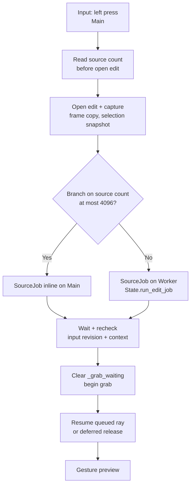
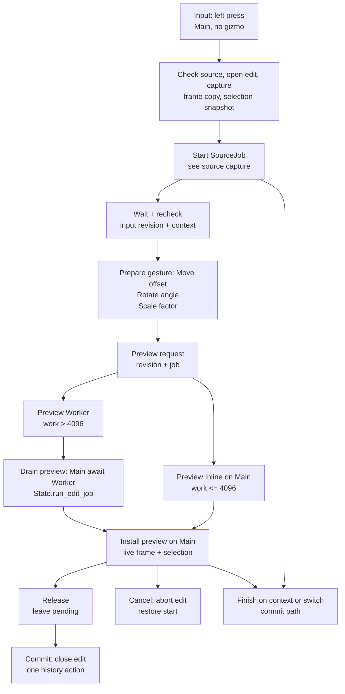
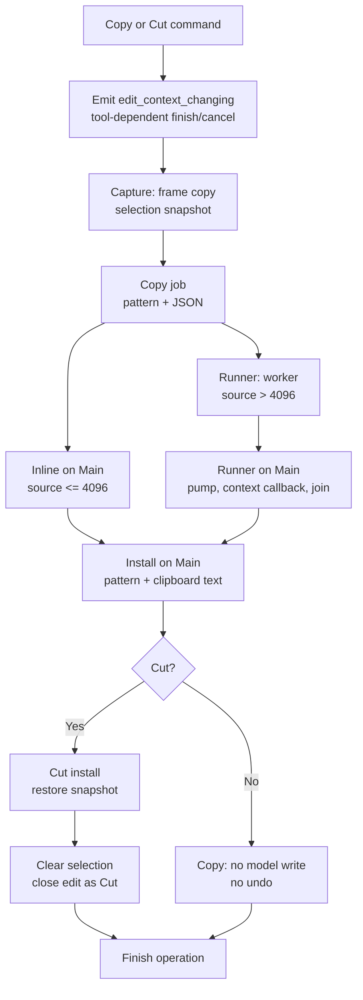
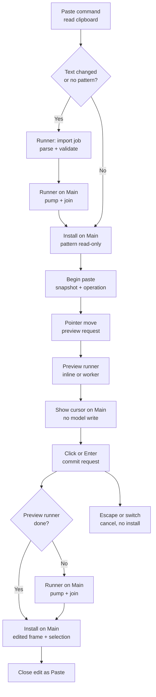
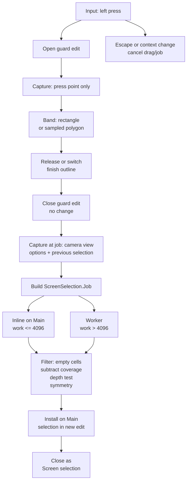
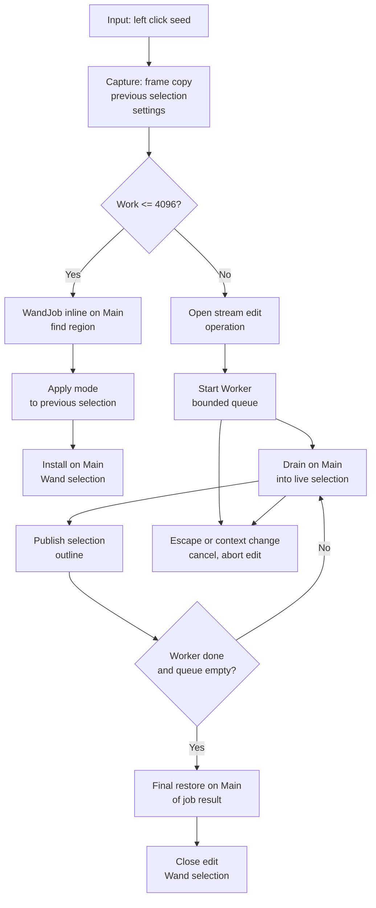

# Transform and selection tool flows

This document describes the current transform, clipboard paste, and selection flows.
Use this static source review to compare flows, not to establish runtime results.
The graphs show main-thread steps and worker steps.
An edge marked `await` must recheck the document, the frame, and the revision after it resumes.
The code does this with `_context_valid`, `State.has_operation`, `job.checkpoint`, and revision counters.

Read `Main` as the main thread. Read `Worker` as the worker pool.
`Capture` freezes the source. `Prepare` builds the request.
`Preview` writes replaceable output. `Apply` runs the accepted work.
`Install` writes accepted output to the live model or selection.
`Commit` closes the edit and records undo. `Cancel` restores the start snapshot.

Two evidence labels appear below.

- **Source fact:** read from the current files.
- **Guess:** not measured. Runtime cost and maintainability gains need a test or a profile.

The maps do not establish performance results.

## Registration and input ownership

`project.godot` sets `Main.tscn` as the main scene and registers `State` as an autoload.
`State._ready` adds the transform, selection, and clipboard plugins with `add_plugin`.
The plugins add their tool nodes to the viewport with `VoxelPlugin.add_editor_node`.

| Plugin | Scenes instantiated by the plugin |
| --- | --- |
| `TransformPlugin` | `Toolbar.tscn`, `Options.tscn`, `MoveTool.tscn`, `RotateTool.tscn`, `ScaleTool.tscn` |
| `SelectionPlugin` | `Toolbar.tscn`, `Options.tscn`, `SelectionPreview.tscn`, `BoxSelectTool.tscn`, `LassoSelectTool.tscn`, `WandSelectTool.tscn` |
| `ClipboardPlugin` | `Options.tscn`, `PasteTool.tscn` |

`PasteTool.tscn` instances `plugins/brush/LineTool.tscn` and sets `PasteTool.gd`.
`PasteTool` therefore uses the line preview engine in `LineTool.gd` and the stamp job in `StrokeTool.gd`.

There is no transform gizmo in the current code.
`TransformTool.handle_input` reads the left mouse button and mouse motion.
A transform press grabs the selection or the whole frame.
It does not call `pick_start` and it does not require a model hit.
The selection tools use a screen shape or a voxel seed pick instead.

| Input | Transform | Selection |
| --- | --- | --- |
| Left press | Grab source. No gizmo. No voxel pick. | Box and Lasso start a screen band. Wand picks a seed voxel. |
| Drag | Update the offset, angle, or factor. | Update the screen band. |
| Release | Leave the transform pending. | Box and Lasso apply the outline. Wand is already streaming or done. |
| Click without drag | Open the exact-value dialog. | Box and Lasso use a 7 px rectangle. Wand uses the seed. |
| Enter | Commit. | No binding. |
| Escape | Cancel. | Cancel the drag or the running job. |

## Transform Move, Rotate, and Scale

The three tools share `TransformTool.gd`.
The source capture and the shared lifecycle are below.
The source graph expands the press. The lifecycle graph shows the full press-to-commit path.
The variant table lists only the actual policy differences.

`_grab_waiting` is true during `SourceJob`.
A release during that time is deferred because `_release` returns while `_grab_waiting` is true.
`_resume_queued_drag` applies the queued ray and calls `_release` when the pointer is up.
The source job runs inline at `INLINE_EDIT_LIMIT` or below.
A larger job awaits `State.run_edit_job`.
`_press` rechecks `_input_revision` and `_context_valid` after the source job.
The gesture preview starts only after that check.
A press during a pending transform calls `_reanchor` and skips `SourceJob`.

`_press` captures `_source_document`, `_source_frame`, the symmetry context, and `State.selection.capture()`.
`SourceJob` reads the selected cells, or the whole frame when the mask is empty.
The job runs inline at `INLINE_EDIT_LIMIT` or below.
A larger job runs through `State.run_edit_job`.
`_apply_preview` installs each accepted revision with `_source_frame.restore(job.edited_frame.capture())`.
The preview therefore writes the live frame inside the open edit.

| Aspect | Move | Rotate | Scale |
| --- | --- | --- | --- |
| Gesture | View-plane offset in whole cells. | Angle around the bounds center on the view axis. | Factor from a view-plane reference vector. |
| Exact dialog | `open_for_move` offset. | `open_for_rotate` angles in degrees. | `open_for_scale` factors. |
| Job | `TransformJob` with `offset`. | `RotateJob` with exact quarter turns, cardinal Euler rotation, or `RotSprite`. | `ScaleJob` with 3D or per-layer 2D sampling. |
| Snap | Whole cells by `roundi`. | `_settings.snap` quarter turns, or 1 degree steps and a 2 degree magnetic pull. | Factors snapped to 0.0001 and clamped to `MIN_SCALE`. |
| Option | None. | `snap`. | `uniform`. |
| Selection follow | `_track_selection` restores `destination_selection`. | Same. | Same. |
| Symmetry | `_reduce_to_fundamental_domain` then `_mirror_destination`. | Same. | Same. |

### Transform modes and masks

- **Source selection mode:** a non-empty selection selects the source. An empty selection selects the whole frame. `SourceJob.selection_mask` is the only source mask.
- **Selection follow:** `_track_selection` is true when the selection is not empty. Each preview restores `destination_selection`, so the selection moves with the cells.
- **Symmetry mask:** `State.selection_context()` supplies the axes and origin. `TransformJob` keeps one representative per symmetry orbit and mirrors the result.
- **Duplicate mode:** absent. `TransformToolSettings` defines `MOVE`, `ROTATE`, and `SCALE` only. `TransformJob` clears source cells that the destination does not cover. Use Copy then Paste to duplicate cells.
- **Destination mask:** absent. `TransformJob` writes its destination with `edited_frame.set_cells(changes, self)` and no selection filter.

### Transform undo and cancel

- `open_stroke()` at press opens one `VoxelEditTransaction`.
- `_end()` at commit closes it. `State.finish_edit` records one history action.
- The action name is `Stroke`. It is the default `close_stroke` name, not a named Transform action.
- `_release` sets `_pending` when `_dragged` is true. Release does not commit.
- Enter, the option bar, a context change, or a tool switch commit the pending transform.
- `_finish_context_edit` calls `_commit_now`. `_exit_tree` calls `_commit`, which can defer the commit until the preview drains.
- Escape calls `_cancel`. It increments the revisions, cancels the jobs, aborts the stroke, and restores the start chunks and selection.
- After `await State.run_edit_job`, `_apply_preview` checks `revision`, `_context_valid`, and `State.has_operation`.

### Transform source edges

- Input: [`TransformTool.handle_input`](../../plugins/Transform/tools/TransformTool.gd) routes mouse and key events.
- Capture: [`TransformTool._press`](../../plugins/Transform/tools/TransformTool.gd) calls `open_stroke` and `State.begin_operation`. It then calls `VoxelFrame.copy_frame` and `State.selection.capture`.
- Source worker: [`TransformTool._press`](../../plugins/Transform/tools/TransformTool.gd) sets `_grab_waiting` before the source job. Above `INLINE_EDIT_LIMIT`, it awaits `State.run_edit_job`.
- Deferred release: [`TransformTool._release`](../../plugins/Transform/tools/TransformTool.gd) returns while `_grab_waiting`. [`TransformTool._resume_queued_drag`](../../plugins/Transform/tools/TransformTool.gd) releases after the grab.
- Prepare: [`TransformTool.SourceJob.run`](../../plugins/Transform/tools/TransformTool.gd) reads the selected cells or the whole frame.
- Preview: [`TransformTool._apply_preview`](../../plugins/Transform/tools/TransformTool.gd) builds `TransformJob`, uses `State.run_edit_job` above `INLINE_EDIT_LIMIT`, and calls `VoxelFrame.restore`.
- Apply: [`TransformTool.TransformJob.run`](../../plugins/Transform/tools/TransformTool.gd) calls `compute_destination`, `_mirror_destination`, and `VoxelFrame.set_cells`.
- Release: [`TransformTool._release`](../../plugins/Transform/tools/TransformTool.gd) sets `_pending`.
- Commit: [`TransformTool._commit_now`](../../plugins/Transform/tools/TransformTool.gd) calls `_end`, which calls `VoxelTool.close_stroke`.
- Cancel: [`TransformTool._cancel`](../../plugins/Transform/tools/TransformTool.gd) calls `abort_stroke` and `State.finish_operation`.
- Variants: [`MoveTool._update_params`](../../plugins/Transform/tools/MoveTool.gd), [`RotateTool.RotateJob.compute_destination`](../../plugins/Transform/tools/RotateTool.gd), and [`ScaleTool.ScaleJob.compute_destination`](../../plugins/Transform/tools/ScaleTool.gd).

## Clipboard copy, cut, and paste

### Copy and cut origin

`_copy_voxels` emits `State.edit_context_changing` first.
It then captures `frame.copy_frame()` and `State.selection.capture()` before the job.
Each open tool handles the signal with its own policy.
An active transform commits. An active paste cancels. Active selection jobs cancel.
This is a source fact. It is not a new universal policy.
An empty selection copies the whole frame.
`ClipboardCopyJob` extends `StampCopyJob.CopyJob`.
It builds the pattern, the full materials, and the pattern center.
It then writes JSON records with 3 integers and 9 material floats.
It also writes selection offsets relative to the center.
A cut writes transparent cells into the snapshot. It does not write the live frame during the job.
The main thread installs the result after the worker drain.
A copy has no model write and no undo action.
A cut opens an edit, restores the cut snapshot, clears the selection, and closes as `Cut`.
A source above 4096 cells uses `State.run_edit_job`.
The runner pumps progress, calls the context callback before each progress update, and joins exactly once.
The callback cancels the job when the document or the frame changes.
The caller installs only after the runner returns and the document, frame, and checkpoint checks pass.
`_exit_tree` uses `job.wait_for_worker` as the same exactly-once join.

#### Copy and cut source edges

- Command: [`ClipboardPlugin.copy_voxels`](../../plugins/Clipboard/ClipboardPlugin.gd) and [`cut_voxels`](../../plugins/Clipboard/ClipboardPlugin.gd) call `_copy_voxels`.
- Context signal: [`ClipboardPlugin._copy_voxels`](../../plugins/Clipboard/ClipboardPlugin.gd) emits `State.edit_context_changing` before the capture.
- Capture: [`ClipboardPlugin._copy_voxels`](../../plugins/Clipboard/ClipboardPlugin.gd) calls `VoxelFrame.copy_frame` and `VoxelSelection.capture`.
- Worker: [`ClipboardCopyJob.run`](../../plugins/Clipboard/ClipboardPlugin.gd) calls `StampCopyJob.CopyJob.run`. A cut then calls `VoxelFrame.set_cells`.
- Install: [`ClipboardPlugin._copy_voxels`](../../plugins/Clipboard/ClipboardPlugin.gd) stores read-only patterns and calls `DisplayServer.clipboard_set`.
- Cut: the same method calls `State.begin_edit`, `VoxelFrame.restore`, `State.clear_selection`, and `State.finish_edit`.
- Cancel: the runner calls the context callback, which calls `job.cancel` when the document or frame changes. The runner joins exactly once.

### Paste placement

`paste_voxels` reads the system clipboard and checks `CLIPBOARD_PREFIX`.
When the text is new or the pattern is empty, `ClipboardImportJob` parses and validates the JSON.
The main thread installs the pattern and the material pattern as read-only dictionaries.
`begin_paste` captures `_line_snapshot = _source_frame.copy_frame()`.
The preview samples this snapshot, not the live frame.
`PasteJob` extends `BrushJob`.
It writes the pattern into `edited_frame` and builds `pasted_selection` from `centers[0] + offset`.
`_show_preview` writes only `$Cursor.show_voxels(_preview_pattern, Color.WHITE)`.
A paste preview does not write the model.

`_commit_line` captures the frame and the job before it cancels the preview.
It verifies the document and frame context.
It opens an edit, restores `job.edited_frame`, restores `job.pasted_selection`, and closes as `Paste`.
`_cancel_edit` finishes the placement operation, cancels the preview, and emits `finished`.
`ClipboardPlugin._on_tool_toggled` calls `_paste_tool._cancel_edit()` when a tool button turns on. The inherited `LineTool.finish_on_switch` also cancels a paste, but the clipboard plugin uses `_cancel_edit` directly.
The import uses `State.run_edit_job`.
The preview uses it above `INLINE_EDIT_LIMIT`.
The runner pumps progress and joins exactly once.
`LineTool._process` updates idle hover only.
`_service_preview` starts the newest preview after the runner returns.
`_finish_preview` checks `job.revision` and `_anchor`.
A commit waits for `_preview_result` before it installs.

`PasteTool._begin_preview_operation` returns `_placement_operation_id`.
`PasteTool._finish_preview_operation` keeps the placement operation open.
`_cancel_edit` finishes it once.
The placement and the preview share one status entry and one cancel path.
These two virtual methods are a narrow status seam for Line and Paste.
They are not a general hook framework.

#### Paste source edges

- Command: [`ClipboardPlugin.paste_voxels`](../../plugins/Clipboard/ClipboardPlugin.gd) reads the clipboard and starts the import.
- Import: [`ClipboardImportJob.run`](../../plugins/Clipboard/ClipboardPlugin.gd) parses and validates the JSON. `ClipboardPlugin.paste_voxels` awaits `State.run_edit_job` for the import.
- Begin: [`PasteTool.begin_paste`](../../plugins/Clipboard/PasteTool.gd) captures `_line_snapshot` and starts the placement operation.
- Preview: [`LineTool._start_preview`](../../plugins/brush/LineTool.gd) builds `PasteJob` and awaits `State.run_edit_job` above `INLINE_EDIT_LIMIT` with `_cancel_preview_if_stale`.
- Operation: [`PasteTool._begin_preview_operation`](../../plugins/Clipboard/PasteTool.gd) returns `_placement_operation_id`. [`PasteTool._finish_preview_operation`](../../plugins/Clipboard/PasteTool.gd) keeps it open.
- Preview output: [`PasteTool._show_preview`](../../plugins/Clipboard/PasteTool.gd) calls `$Cursor.show_voxels`.
- Worker body: [`PasteJob.run`](../../plugins/Clipboard/PasteTool.gd) calls `BrushJob.run` and builds `pasted_selection`.
- Commit: [`PasteTool._commit_line`](../../plugins/Clipboard/PasteTool.gd) calls `State.begin_edit`, `VoxelFrame.restore`, `State.selection.restore`, and `State.finish_edit`.
- Cancel: [`PasteTool._cancel_edit`](../../plugins/Clipboard/PasteTool.gd) finishes `_placement_operation_id` once and calls `LineTool._cancel_edit`.

## Selection Box, Lasso, and Wand

### Box and Lasso

The press stores `_screen_press` and `_last_pos`.
The camera and options are captured at `_commit_screen` after the outline finishes.
`SelectTool` owns the shared press, band, release, and worker path.
Box and Lasso supply only the shape hooks.
Box uses `_screen_rectangle`.
A click smaller than `CLICK_SIZE` uses a 7 px square.
Lasso samples the pointer path at `SCREEN_STEP` of 6 px and stops at `SCREEN_POINT_LIMIT` of 512 points.
It uses a polygon when it has 3 or more points. Otherwise it uses the click rectangle.
`_commit_screen` captures the camera with `ScreenSelection.view_of`, the symmetry context with `State.selection_context()`, and `previous_selection` with `State.selection.capture()`.
It reads `mode`, `depth_test`, and `include_empty`.

`ScreenSelection.Job.run` projects every occupied cell.
It adds empty cells inside the frame bounds when `include_empty` is true.
In subtract mode it also tests the previous selected cells.
It applies `_visible` when `depth_test` is true.
It expands the region through the symmetry context.
It applies the selection mode last.
The install step opens a new edit, restores `job.result`, closes as `Screen selection`, and emits `selection_changed`.
The guard edit from the press closes with no change before the job starts.
A tool switch calls `finish_on_switch`. It applies the current outline as a release before the detach.
A pending job finishes after the detach.
Escape or a context change cancels the job.
`_finish_screen_selection` drops the result when `_screen_job != job`.

| Aspect | Box | Lasso |
| --- | --- | --- |
| Shape | Screen rectangle. | Sampled screen polygon. |
| Click | 7 px rectangle. | 7 px rectangle when fewer than 3 points. |
| Drag | Rectangle from press to pointer. | Polyline with 6 px steps and a 512 point limit. |
| Worker | Same `ScreenSelection.Job` and `IMMEDIATE_LIMIT`. | Same. |
| Switch | Applies the current outline. | Applies the current outline. |

#### Box and Lasso source edges

- Input: [`SelectTool.handle_input`](../../plugins/selection/tools/SelectTool.gd) routes mouse and key events.
- Press: [`SelectTool._screen_button`](../../plugins/selection/tools/SelectTool.gd) calls `open_stroke` and stores `_screen_press` and `_last_pos`.
- Shape: [`BoxSelectTool._commit_shape`](../../plugins/selection/tools/BoxSelectTool.gd) sends a rectangle. [`LassoSelectTool._commit_shape`](../../plugins/selection/tools/LassoSelectTool.gd) sends a polygon.
- Job capture: [`SelectTool._commit_screen`](../../plugins/selection/tools/SelectTool.gd) calls `ScreenSelection.view_of`, `State.selection_context`, and `State.selection.capture`.
- Job: [`SelectTool._commit_screen`](../../plugins/selection/tools/SelectTool.gd) builds `ScreenSelection.Job` and uses `State.run_edit_job` above `IMMEDIATE_LIMIT`.
- Filter: [`ScreenSelection.Job.run`](../../plugins/selection/ScreenSelection.gd) calls `_covers`, `_visible`, `EditContext.expand`, and the mode step.
- Install: [`SelectTool._finish_screen_selection`](../../plugins/selection/tools/SelectTool.gd) calls `State.begin_edit`, `VoxelSelection.restore`, and `State.finish_edit`.
- Cancel: [`SelectTool._cancel_screen_job`](../../plugins/selection/tools/SelectTool.gd) cancels the job and finishes the operation.
- Switch: [`SelectionPlugin.deactivate_tool`](../../plugins/selection/SelectionPlugin.gd) calls `finish_on_switch`.

### Wand

The wand uses the picked hit as its seed. The seed must be an occupied cell.
`WandJob` calls `VoxelRegionSearch.find` with an empty selection mask.
The current selection is not a barrier.
`_settings.connected` selects a six-face flood or a full scan.
The job expands the matches through the symmetry context and applies the mode.
Work at 4096 or below runs inline and installs in a new edit as `Wand selection`.
Larger work opens an edit and starts a worker with a bounded `BatchQueue`.
`_service_selection` drains batches into live `State.selection` with a 2000 us budget and 256-cell slices through `BatchCursor.apply_slice`.
The callback receives `(keys, start, end)` and returns `bool`. The cursor advances only on `true`. A stale context leaves the slice pending for the next attempt. A cancelled owner discards its own cursor.
It publishes `selection_changed` after a merge.
When the worker is done and the cursor is done, it cancels the queue. It joins the worker, restores `job.result`, and closes the edit as `Wand selection`.
Escape or a context change retires the job, aborts the edit, and publishes the restored selection.
The reaper joins the worker without blocking the main thread.
The wand does not read `depth_test` or `include_empty`.
The options bar hides both controls for the wand.

Fill and Wand share `VoxelRegionSearch.BatchCursor.apply_slice(limit, apply)`.
`BatchQueue` holds at most four batches. A full queue blocks the producer.
Each tool keeps its own queue, budget, cancel path, and undo action.
See the [composition guide](composition.md) for signatures, ownership, and reuse limits.

#### Wand source edges

- Input: [`WandSelectTool.handle_input`](../../plugins/selection/tools/WandSelectTool.gd) calls `_pick_start` and `_commit`.
- Capture: [`WandSelectTool._commit`](../../plugins/selection/tools/WandSelectTool.gd) calls `VoxelFrame.copy_frame`, `State.selection.capture`, and `State.selection_context`.
- Worker: [`WandJob.run`](../../plugins/selection/tools/WandSelectTool.gd) calls `VoxelRegionSearch.find`, `EditContext.expand`, and the mode step.
- Service: [`WandSelectTool._service_selection`](../../plugins/selection/tools/WandSelectTool.gd) drains `BatchCursor` and awaits frames.
- Stream: [`WandSelectTool._drain_selection_batches`](../../plugins/selection/tools/WandSelectTool.gd) calls `State.selection.add` or `erase`.
- Publish: [`WandSelectTool._publish_selection`](../../plugins/selection/tools/WandSelectTool.gd) emits `State.selection_changed`.
- Finish: [`WandSelectTool._finish_selection`](../../plugins/selection/tools/WandSelectTool.gd) calls `VoxelSelection.restore` and `State.finish_edit`.
- Cancel: [`WandSelectTool._cancel_selection`](../../plugins/selection/tools/WandSelectTool.gd) calls `_retire_job`, `State.cancel_edit`, and `_publish_selection`.
- Reaper: [`WandSelectTool._reap_retired_jobs`](../../plugins/selection/tools/WandSelectTool.gd) joins retired workers.

### Selection combine modes

Both jobs capture `previous_selection` before the search.
Both apply symmetry before the mode step.

| Mode | `ScreenSelection.Job` | `WandJob` | Result |
| --- | --- | --- | --- |
| `REPLACE` | `result = {}` then add the region. | Same. | The previous selection is discarded. |
| `ADD` | `result = previous_selection.duplicate()` then add the region. | Same. | The previous selection is kept. |
| `SUBTRACT` | `result = previous_selection.duplicate()` then erase the region. It also adds covered previous selected cells to the region. | Same baseline. It does not add covered previous selected cells. | Matching cells leave. Empty selected cells can leave only in ScreenSelection. |

## Behavior matrix

| Flow | Mode and captured state | Main or worker | Undo action | Cancel |
| --- | --- | --- | --- | --- |
| Transform Move | Selection or whole frame, frame copy, selection snapshot, symmetry. | Main input and install. Worker above 4096. | `Stroke` | Abort edit, restore start. |
| Transform Rotate | Same, plus pivot, view axis, Euler angles. | Same. | `Stroke` | Same. |
| Transform Scale | Same, plus pivot, scale factors, `uniform`. | Same. | `Stroke` | Same. |
| Copy | Context signal, selection or whole frame, frame copy. | Inline at 4096 or below. `State.run_edit_job` above. | None | Cancel job. No model write. |
| Cut | Same, plus `cut_source`. | Same. | `Cut` | Cancel job. No install. |
| Paste | Pattern, selection pattern, material pattern, line snapshot. | Preview runner inline or worker. Commit on main. | `Paste` | `_cancel_edit`. No install. |
| Box and Lasso | Screen shape, camera, previous selection, options. | Inline at 4096 or below. Worker above. | `Screen selection` | Cancel job, drop result. |
| Wand small | Seed, material, previous selection, mode. | Inline. | `Wand selection` | Cancel job. |
| Wand stream | Same, plus queue and cursor. | Worker produces. Main drains. | `Wand selection` | Abort edit, retire job, restore selection. |

## Implemented migrations and remaining candidates

Three former candidates are now working-tree code migrations:

- Clipboard copy, cut, and import use `State.run_edit_job`.
- Line preview uses `State.run_edit_job`. `LineTool._process` updates idle hover only.
- Paste shares `_placement_operation_id` through `_begin_preview_operation` and `_finish_preview_operation`.

These migrations are in the verified modular selection.
This page does not claim a performance result.

The table lists the remaining candidates.
Each candidate names the existing mechanism, its consumers, the contract to preserve, and the tradeoff.

| Candidate | Existing mechanism and consumers | Preserved contract | Tradeoff | Evidence |
| --- | --- | --- | --- | --- |
| Extract the selection mode step. | `VoxelSelection` has `union`, `subtract`, `capture`, and `restore`. `ScreenSelection.Job.run` and `WandJob.run` repeat the replace, add, and subtract baseline. | `REPLACE` drops the previous selection. `ADD` keeps it. `SUBTRACT` keeps it and erases the region. ScreenSelection keeps its extra covered-cell step. | The helper saves few lines. It must not hide the ScreenSelection coverage rule. | Source fact. Runtime gain is a guess. |
| Merge Box and Lasso into one shape tool. | `SelectTool` already owns press, band, release, switch, and worker flow. `BoxSelectTool` and `LassoSelectTool` supply only shape hooks. | Keep the 7 px click, the 6 px lasso step, the 512 point limit, the polygon rule, and `finish_on_switch`. | One class must branch on the shape. The tool enum and toolbar stay. | Source fact. Maintainability gain is a guess. |
| Share the clipboard record schema. | `CLIPBOARD_PREFIX`, `VOXEL_RECORD_SIZE`, `JSON.stringify`, and record validation live in `ClipboardPlugin`. `ClipboardCopyJob.run` and `ClipboardImportJob.run` are the consumers. | Keep the `voxel_voxels` and `voxel_selection` keys. Keep 3 integers and 9 floats per record. Keep the 0 to 1 value check. | One schema helper adds a file. Old clipboard text must stay compatible. | Source fact. Compatibility risk is a guess until tested. |

## Caveats and unverified points

- The verification history is in the composition guide. This page does not claim a performance result.
- The transform history action is `Stroke`. It is not named `Transform`.
- Transform has no gizmo. Transform has no duplicate mode. Transform has no destination mask.
- Transform previews write the live frame. Paste previews write only the cursor.
- An active transform commits on a context change and on a tool switch. An active paste cancels on a tool switch.
- A held Box or Lasso drag applies the current outline on a tool switch. A streaming wand continues after a switch.
- Wand ignores `depth_test` and `include_empty`. The options bar hides both controls for the wand.
- Paste shares one placement operation with its preview through `_begin_preview_operation` and `_finish_preview_operation`.
- Copy and cut use `State.run_edit_job`. The runner joins exactly once.
- Line preview uses `State.run_edit_job`. `LineTool._process` updates idle hover only.
- Box and Lasso use a guard edit on press and a second edit for the selection install.
- `SelectionPreview` receives `show_selection(State.selection, progressive)`. Its internal draw path is outside this document.
- `Toolbar.gd`, `SelectionPreview` internals, and `Clipboard/Options.gd` were not read for this document. The graphs use the plugin callers and the tool scripts.
- See [shared paths and utilities](shared-and-utilities.md) for the common input and rendering flows.

## Inventory

The inventory lists the exact files used for the claims above.

| Area | Files read |
| --- | --- |
| Registration | [`project.godot`](../../project.godot), [`VoxelPlugin.gd`](../../VoxelPlugin.gd), [`State.gd`](../../Globals/State/State.gd) |
| Transform | [`TransformPlugin.gd`](../../plugins/Transform/TransformPlugin.gd), [`TransformTool.gd`](../../plugins/Transform/tools/TransformTool.gd), [`MoveTool.gd`](../../plugins/Transform/tools/MoveTool.gd), [`RotateTool.gd`](../../plugins/Transform/tools/RotateTool.gd), [`ScaleTool.gd`](../../plugins/Transform/tools/ScaleTool.gd), [`TransformDialog.gd`](../../plugins/Transform/tools/TransformDialog.gd), [`TransformToolSettings.gd`](../../plugins/Transform/TransformToolSettings.gd), [`Options.gd`](../../plugins/Transform/Options.gd), [`RotSprite.gd`](../../plugins/Transform/RotSprite.gd), [`settings.tres`](../../plugins/Transform/settings.tres) |
| Transform scenes | [`MoveTool.tscn`](../../plugins/Transform/tools/MoveTool.tscn), [`RotateTool.tscn`](../../plugins/Transform/tools/RotateTool.tscn), [`ScaleTool.tscn`](../../plugins/Transform/tools/ScaleTool.tscn), [`TransformDialog.tscn`](../../plugins/Transform/tools/TransformDialog.tscn), [`Options.tscn`](../../plugins/Transform/Options.tscn) |
| Clipboard | [`ClipboardPlugin.gd`](../../plugins/Clipboard/ClipboardPlugin.gd), [`PasteTool.gd`](../../plugins/Clipboard/PasteTool.gd), [`PasteTool.tscn`](../../plugins/Clipboard/PasteTool.tscn), [`LineTool.gd`](../../plugins/brush/LineTool.gd), [`BrushTool.gd`](../../plugins/brush/BrushTool.gd), [`StrokeTool.gd`](../../plugins/brush/StrokeTool.gd), [`StampCopyJob.gd`](../../plugins/brush/StampCopyJob.gd), [`BrushToolSettings.gd`](../../plugins/brush/BrushToolSettings.gd) |
| Selection | [`SelectionPlugin.gd`](../../plugins/selection/SelectionPlugin.gd), [`SelectTool.gd`](../../plugins/selection/tools/SelectTool.gd), [`BoxSelectTool.gd`](../../plugins/selection/tools/BoxSelectTool.gd), [`LassoSelectTool.gd`](../../plugins/selection/tools/LassoSelectTool.gd), [`WandSelectTool.gd`](../../plugins/selection/tools/WandSelectTool.gd), [`ScreenSelection.gd`](../../plugins/selection/ScreenSelection.gd), [`ScreenBand.gd`](../../plugins/selection/ScreenBand.gd), [`SelectionToolSettings.gd`](../../plugins/selection/SelectionToolSettings.gd), [`Options.gd`](../../plugins/selection/Options.gd), [`settings.tres`](../../plugins/selection/settings.tres) |
| Selection scenes | [`BoxSelectTool.tscn`](../../plugins/selection/tools/BoxSelectTool.tscn), [`LassoSelectTool.tscn`](../../plugins/selection/tools/LassoSelectTool.tscn), [`WandSelectTool.tscn`](../../plugins/selection/tools/WandSelectTool.tscn), [`SelectionPreview.tscn`](../../plugins/selection/SelectionPreview.tscn), [`Options.tscn`](../../plugins/selection/Options.tscn) |
| Shared state | [`VoxelEditTransaction.gd`](../../Globals/State/VoxelEditTransaction.gd), [`VoxelSelection.gd`](../../Globals/State/VoxelSelection.gd), [`VoxelRegionSearch.gd`](../../Globals/State/VoxelRegionSearch.gd), [`VoxelFrame.gd`](../../Globals/State/Document/VoxelFrame.gd), [`VoxelTool.gd`](../../Globals/State/Tools/VoxelTool.gd) |

`SelectionPreview.tscn` is listed because `SelectionPlugin` instantiates it.
Its script internals are not part of the claims above.
